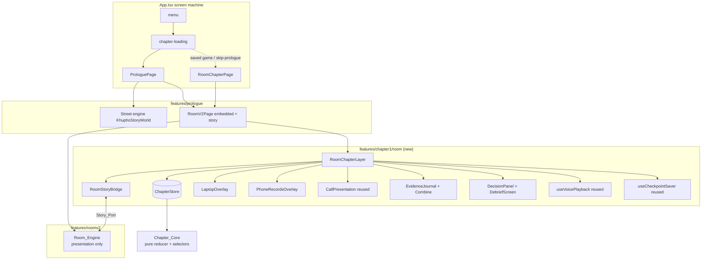
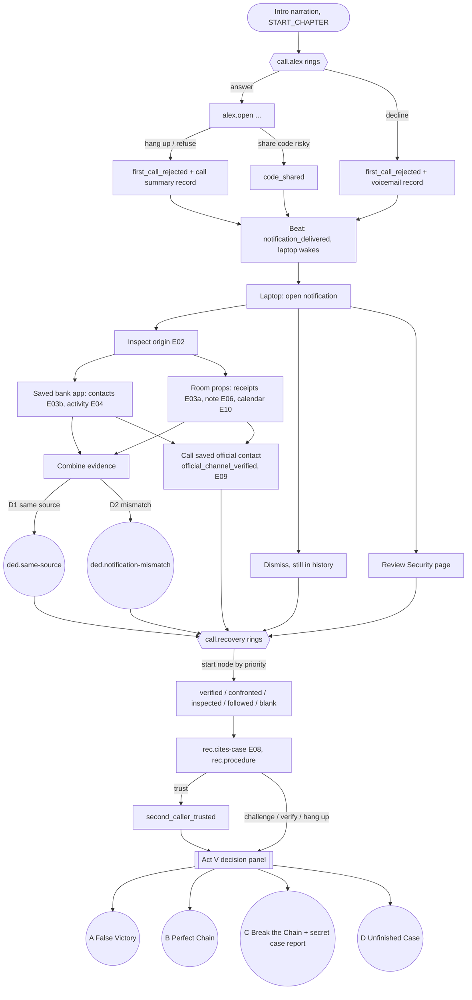

# Design Document: Chapter 1 Double Deception ("The Urgent Call: The False Victory")

## Overview

Chapter 1 becomes a room-bound psychological mystery of about 18 to 22 minutes. The player rejects an obvious fake bank-security call (Layer 1), then receives a laptop notification and a third call that look like the answer to the first scam (Layers 2 and 3). All three sources trace back to the same unverified origin. The chapter teaches one habit: a warning is trustworthy only when it reaches you through a channel you established before the scare.

Summary of the main decisions (details in the sections below):

| # | Decision | Why |
|---|---|---|
| D1 | Host = Room v2 (`features/roomv2`) reached through the existing prologue. A new `features/chapter1/room/` layer owns the Chapter store and all overlays. The Room_Engine gets an optional Story_Port and stays a presentation engine. | Reuses the room, keeps `/roomv2` working, keeps one source of truth (Chapter_State). |
| D2 | The Chapter_Core is extended, not forked: two new actions (`DEVICE_ACTION`, `COMBINE_EVIDENCE`), data-driven call rings, beats, objectives, decision effects and ending rules, plus `deductions` and `sources` in Scenario_Data. | Lets the validator and the reachability analyzer cover the new content. |
| D3 | The laptop UI is an accessible HTML overlay (`Laptop_Overlay`) opened from the 3D inspect pose. The 3D laptop screen only mirrors a small frame (badge and headline). | Keyboard and screen-reader access, i18n through react-i18next, jsdom tests. A canvas UI would need uv picking and a second text system. |
| D4 | The call UI is reused unchanged. The 3D phone model (R3F `PhoneModel3D`) cannot mount in the Room v2 plain-Three canvas, so it is drawn in a small transparent R3F overlay canvas that feeds the existing `PhoneScreenSink`. The 2D fallback mode is the safe default. | `PhoneModel3D` needs R3F `useThree`. `CallPresentation` already supports `model` and `fallback` modes. |
| D5 | The old street chapter is parked: files kept, unrouted, excluded from the quality gates. | The old scenario is replaced, and the core IDs and rules change. Keeping it compiling would need a second engine. This is open question Q1. |
| D6 | Save format version 3 (`scammaze_save_v3`). Older keys are reported as `incompatible`, never migrated. | Old action logs cannot replay against a new scenario. |
| D7 | Deductions can only set a claim to `inconclusive`. Only an Independent_Channel discovery (`ev.official-confirmation`) can set `contradicted`. | A deduction is the player's reasoning, not proof. This matches the existing rule that the bank app is not an independent channel. |
| D8 | No timers in the core or in the choices. Calls ring when authored state conditions hold and the player is free. The only delays are presentation beats (camera settle, sound start). | Requirement 12. |

## Audit (Phase 0)

The audit was done by reading the files below on branch `feat/chapter-01-double-deception` (from `main` @ `37eeedd`). Baseline run in this task: `pnpm test` passes (134 files, 1211 tests, 126 s). `pnpm typecheck` and `pnpm build` were not run in this task. "Verified by tests" means a test file for the behavior exists and the full suite passed; the tests were read, not individually audited.

### Documents read

`README.md`, `AGENTS.md`, `.kiro/steering/{architecture,product,safety,language,audience,icons,coding-standards,kiro-workflow,gameplay-rules,visual-quality}.md`, `docs/product/PRODUCT_POSITIONING.md`, `docs/PROJECT_PROGRESS.md` (head), specs `chapter-01-the-urgent-call`, `chapter-01-voice-narrative`, `game-phone-call-ui-redesign`, `scenario-validation`, `gameplay-qa-automation`, `shared-world-engine` (design headings and tasks), and the skills `scam-scenario-authoring`, `gameplay-testing`, `threejs-world-engine` (procedures applied: validate scenario, reachability, seeded property tests, dispose resources).

### Findings

| # | Area | Finding (with path) | Status |
|---|---|---|---|
| A1 | Flow | `app/App.tsx`: screen machine `menu` to `chapter-loading` to `prologue` or `chapter`. A new game plays `ProloguePage` (neighborhood, then Room v2 through house no. 59). Saved games and `?skip-prologue` render `ChapterOnePage` (street, Sam). `ProloguePage` has no exit to a chapter: the room ends with the engine's own "end of prologue" overlay. | Verified by reading; `prologue.test.ts`, `App.chapter.test.tsx` exist |
| A2 | Room v2 | `features/roomv2/game/engine.ts` (plain Three.js, ~58 KB). Prop IDs: `switch desklamp bedlamp kitchenlight window laptop chair note receipts mug phone calendar photo fridge kettle bed jacket umbrella door`. Inspect POSES for laptop, note, receipts, mug, phone, window, calendar, photo, fridge, bed. Story is hard-coded in `updateStory`: `calm`, `presilence`, `ringing`, `call`, `declined`, `missed`, `done` (ring after 70 to 300 s, 42 s miss timer, canned call captions, `ui.ended`). Laptop inspect only "types" canned text. Interact is gated by `hovered` id. `RoomOptions` (`game/outside.ts`): `standby`, `onExitStart`, `onExit`. | Verified by reading. No engine test exists (only `home.test.ts` for khupho). Behavior is documented only |
| A3 | Room screens | `game/screens.ts`: `LaptopScreen.draw(awake, time, typed)` (canvas 1280x800: inbox, music widget, an old "Northgate Bank 18/10" notification card, taskbar). `PhoneScreen.draw(mode, ...)` with modes `aod lock ringing call sms dark`; the call mode already shows a fictional `+000 0000 1234`. Texts come from `tr()` keys `roomv2.game.*` in `i18n/locales/{en,vi}/worlds/roomv2.ts`. | Verified by reading |
| A4 | Prologue | `features/prologue/ProloguePage.tsx`: owns pause menu, settings, white doorway, standby room build (`mountRoom`), Escape handling for street and room, `onUI` pointer-lock state. `HomeCallOverlay` plus `homeCallClips.ts` (3 voiced lines, `PROLOGUE_VOICE_BASE`). `prologueGate.ts`: new game plays the prologue; saved game or `skip-prologue` skips it. | `prologue.test.ts` covers the gate; the page itself is untested |
| A5 | Core types | `game/narrative/types.ts`: 14 `CoreAction` kinds, `ChapterState` (flags record, `claims`, `pressure`, `events`), `Condition` (10 kinds), `Effect` (6 kinds), `ScenarioDefinition`. ID unions come from `chapter1/ids.ts` (`as const` arrays, whitelisted by `isCoreAction` and `createInitialState`). | Verified by tests (`reducer.test.ts`, `properties/*`) |
| A6 | Core chapter-specific code | `reducer.ts` hard-codes `call.scam-1`, `call.callback`, `call.followup`, the official-line `VERIFY_CLAIM`, and `follow-request` to `money_moved`. `objectives.ts` has per-objective rules. `outcome.ts` hard-codes the four outcomes. `selectors.ts` has `CALL_LOG_EVIDENCE`. `reachability.ts` has `ENGINE_READ_FLAGS`. `useCallTriggers.ts` uses timers (3 s, 60 s, 20 s, 90 s, 45 s). | Verified by reading. This code must change for the new scenario |
| A7 | Validation | `validateScenarioIssues` (V1 references and schema, V3 shape, V4 impossible conditions), `analyzeReachability` (state-space BFS with `relevantFlags`, soft locks, unreachable outcomes, option bounds), `validateChapterContent`. Tests: `validateScenario.test.ts`, `reachability.test.ts`, `properties/scenarioValidation`, `noSoftLock`, `terminal`, `evidenceCoverage`, `content.test.ts`. | Verified by tests |
| A8 | Test infra | `src/test/seededRandom.ts` (LCG, no PBT library), `chapterRuns.ts` (generators, `assertInvariants`, 200 cases, guided policy), `callStates.ts`, `fakeAudioPort.ts`, `fakeAssets.ts`, `chapterIntro.ts`. `narrative/boundaries.test.ts` and `voice/boundaries.test.ts` enforce import limits. | Verified by tests |
| A9 | Saves | `game/saves/saveGame.ts`: envelope v2 (`scammaze_save_v2`), v1 migrated to a start checkpoint, `SAVE_MAX_ACTIONS = 1000`, `parseSaveEnvelopeV2`, `createLocalStorageSaveSource`. `chapterProgress.ts`: `encodeProgress`, `restoreProgress` (strict and lenient replay, pose clamped with the street play area). `chapterSession.ts`: `applyRestoredProgress`, trimmed flag. `app/continueAvailability.ts`: reason codes `none`, `invalid`. | Verified by tests (`saveGame.test.ts`, `chapterProgress*.test.ts`, `savedPathsStillReplay.test.ts`) |
| A10 | Voice | `game/voice/*`: manifest (`chapter1.manifest.ts`, generated, 72 KB), `selectClip` (never shows English audio as Vietnamese without the setting), `VoiceDialoguePlayer` (target key `graphId:nodeId`, gate, replay, mute), `webAudioEngine`, `buildVoiceJobs` (cast table, tone multipliers, one job per spoken node and locale), generator `scripts/generate-chapter1-voice.mjs` plus `.ps1` (Windows speech, MP3 to `public/audio/chapter01/<locale>/<nodeId>.mp3`, cache `.voice-cache` is git-ignored). The manifest declares 54 en and 54 vi clips for the old scenario. | Verified by tests (`voice/*.test.ts`); real audio never verified |
| A11 | Call UI | `features/chapter1/call/*`: `CallPresentation` (DOM only), `PhoneCallScreen`, `CallSubtitleOverlay`, `PlayerChoiceOverlay`, `callLayout`, `callDialogueView`, `PhoneScreenHost`, `phoneScreenSink`. `PhoneModel3D` is an R3F component that uses `useThree`, loads `CALL_PHONE_GLB` and publishes the projected screen rectangle to the sink. It is mounted by `ChapterOneCanvas` only. | Verified by tests (jsdom); no real GPU run |
| A12 | Chapter UI | `ChapterOnePage.tsx` (44 KB) wires store, saves, voice, call, phone, journal, decision, debrief, HUD and the street canvas. Reusable parts: `hud/*`, `journal/EvidenceJournal`, `decision/DecisionPanel`, `debrief/DebriefScreen`, `phone/PhoneOverlay` (call history, messages, bank app), `pause/PauseMenu`, `intro/*`, `comfort/*`, `focusTrap`, `overlays`. Street-only parts: `ChapterOneCanvas`, `world/*`, `interaction/*`, `dialogue/DialoguePanel` (Sam), `useCallTriggers` (timers). | Verified by tests |
| A13 | i18n | `i18n/locales/{en,vi}/chapter1/{hud,outcome,phone,story}.ts`, `worlds/roomv2.ts`. Narrative overlay `i18n/narrative/chapter1.vi/{core,decisions,dialogues,evidence,phone,world}.ts`, keys like `dialogues/<graphId>/lines/<lineId>`. `localize.ts` walks the scenario. `narrative.ts` builds the display scenario by locale. | Verified by tests (`content.vi.test.ts`, `narrative.test.ts`, `localize.property.test.ts`) |
| A14 | Shared types | `packages/shared-types/src/index.ts`: `SceneId` already contains `apartment`; `GameSettings` has `subtitlesEnabled`, `phoneVoiceFilter`, `englishVoiceFallback`, `reducedStress`, `reducedMotion`. | Verified by reading |

### Reusable systems

Room v2 apartment, props, POSES, audio emitters, rain and city; prologue white doorway, pause and settings; the whole call UI; voice manifest, selection, player, engine and generator; evidence journal, decision panel, debrief screen, HUD pieces, intro narration, comfort provider; save envelope, replay and trimmed notice; the narrative reducer pipeline, conditions, effects, validator and reachability analyzer; the seeded test harness.

### Missing pieces

1. A Story_Port and a way to suppress the Room_Engine's own call timeline.
2. A room-bound chapter host (store, overlays, HUD, saves) that does not depend on the street canvas.
3. Core support for device actions, combinations (deductions), provenance sources, beats and data-driven rings, objectives, decisions and endings.
4. The laptop interface, the phone records entry points and the Combination UI.
5. A 3D phone overlay canvas for Room v2 (or an accepted 2D fallback).
6. New scenario content, Vietnamese overlay, voice cast entries and clips.
7. Save format v3 with an `incompatible` reason code and its menu text.
8. Tests for the Room_Engine bridge (none exist today), and a rewrite or parking of about 35 core tests and about 39 chapter UI tests that name the old scenario (see the triage task).

### Key risks found by the audit

- `ProloguePage` ends the room with the engine's own overlay. The new layer must replace that exit, or the player never reaches the debrief.
- `PhoneModel3D` cannot mount in Room v2 without a second WebGL context (the street engine, the room engine and the menu canvas already exist). Not measurable without a real GPU.
- About 74 files reference `CHAPTER_1_SCENARIO`. A scenario replacement is a wide change and needs the triage task before the content tasks.
- The voice generator needs Windows speech voices (`Microsoft David`, `Mark`, `Zira`, `An`). If a voice is missing, the clip is `missing` and the game falls back to subtitles.

## Architecture

### Layers and ownership



Rules:

1. Only the Chapter_Core changes Chapter_State. `RoomChapterLayer` dispatches `CoreAction`s and reads selectors. The engine never reads the store.
2. The Room_Engine reports "player used prop X" and "inspect key K" through the bridge and receives commands (`setPhoneMode`, `ring`, `setLaptopFrame`, `chime`, `closeInspect`). Commands are derived from selectors in one place (`roomPresentation.ts`, pure, unit-tested).
3. The engine's `story` field gets a new value `'external'`. In that value `updateStory` returns at once, `finish`, `answerCall`, `declineCall`, `missCall` and the `ended` overlay are never reached, and `RoomV2Page` does not draw its ending block.

### Replacing the engine's story states (Decision 1)

| Engine today | In story mode |
|---|---|
| `story` machine `calm to presilence to ringing to call to done` | `story = 'external'`. The layer calls `ring(true)` when the store has a ringing call, `setPhoneMode('call')` while active, `setPhoneMode('lock')` otherwise. The pre-ring silence (`duckCity`, `stinger`) becomes `setMood('quiet')` that the layer sets for 4 seconds of presentation before the ring command (a beat, not a rule). |
| `label(id)` for `phone` ("pick up" when ringing) | `port.label(id)` returns text from the display scenario prompts and the layer state. A `null` result uses the default `tr()` label. |
| `inspectLines(id)` (canned flavor) | `port.inspectLines(id)` returns the `InteractableDef.inspectionText` of the display scenario for `note`, `receipts`, `calendar`, so evidence text has one source. |
| `actionsFor('phone')` answer or decline | `port.actions(id)`: ringing gives F answer and R decline; otherwise F "open records". Laptop gives F "use laptop". |
| `endInspect` blocked while ringing | `port.canLeaveInspect(id)` is false while a call is ringing, active, or an overlay is open. |
| `laptop` `typed` mechanic | Removed in story mode (the overlay replaces it). |
| `ui.ended` and `continueAfterEnd` | Not used. The layer shows its own ending transition and the debrief. |

### The laptop: HTML overlay versus canvas UI (Decision D3)

Chosen: HTML overlay opened when the camera finishes the laptop inspect pose (the engine reports `inspect-ready`). Not chosen: drawing the interface into `LaptopScreen`'s canvas texture.

| Criterion | HTML overlay | Canvas texture UI |
|---|---|---|
| Keyboard and screen reader | Native elements, focus trap, `aria-*` | Needs a parallel invisible DOM |
| Localization | `react-i18next`, plain strings | `tr()` plus manual wrapping and measuring |
| Hit testing | DOM | Ray to uv mapping on a tilted screen |
| Tests | Testing Library in jsdom | No canvas in jsdom |
| Diegetic feel | Lower. Mitigated by a CSS bezel, the 3D screen behind it, and the badge and headline mirrored on the 3D screen | Higher |

`LaptopScreen.draw` gets one optional `frame` argument (`{ badge: 'none' | 'new' | 'read'; headline: string }`). When a frame is present, the old corner notification card is replaced by the story headline. The laptop overlay is `role="dialog"`, closes with Escape or the Close button, and returns the player to the seated or standing inspect pose.

### The phone: records overlay and the call overlay

- Not in a call: inspecting the phone opens `PhoneRecordsOverlay`, an adapted `phone/PhoneOverlay` (call history with details, messages, voicemail summary, "Call saved contact" when an Independent_Channel contact is known).
- Ringing: the engine shows `ringing` on the 3D desk phone. The prompt "Pick up" starts `CallPresentation` (state `ringing`, buttons Accept and Decline) over the room.
- 3D phone model: `RoomPhoneModelLayer` mounts a transparent R3F `<Canvas frameloop="demand">` above the engine canvas only while a call is shown, renders the unchanged `PhoneModel3D`, and publishes the screen rectangle to the existing sink. `CallPresentation` switches to `fallback` after 200 ms without a rectangle. Default for this spec: build the 2D path first (`modelAllowed={false}`) and add the overlay canvas in its own task with automatic fallback. Open question Q3 asks whether the extra WebGL context is acceptable. No performance claim is made: real GPU not measured.

### Flow and routes

New game: `menu to loading to ProloguePage (street) to white doorway to Room v2 + RoomChapterLayer to ending to debrief`. `ProloguePage` receives a `story` prop `{ session, saveSource, onReturnToMenu }`. When the stage is `room`, it passes `<RoomChapterLayer>` as an `overlay` child of `RoomV2Page`. The bridge object is created in `ProloguePage` before the engine builds (stable ref), so the standby build already has the port. The room's door exit (`onExit`) is disabled in story mode after `START_CHAPTER` (the layer sets `bridge.doorLocked`), so the player cannot walk out mid-story; the label for the door becomes an inspect caption ("Not now").

Saved game and `skip-prologue`: `App.tsx` renders `RoomChapterPage` (new) instead of `ChapterOnePage`. It mounts `RoomV2Page` with `embedded`, no `standby`, plus the same layer. `chapterRegistry.getChapter('chapter-1').gameplayAvailable` stays true.

The `HomeCallOverlay` story event, the street, the doorway and the loading flow are unchanged. `ProloguePage` Escape handling gets one condition: skip when `bridge.overlayOpen()`.

### Parking the old street chapter (Decision D5)

Kept, unrouted, excluded from `tsc` and Vitest through an `exclude` list: `features/chapter1/{ChapterOnePage,ChapterOneCanvas,useCallTriggers}.tsx|ts`, `features/chapter1/world/*`, `features/chapter1/interaction/*`, `features/chapter1/dialogue/*`, the old scenario modules under `game/narrative/chapter1/dialogues/{scamCall,callback,followup,shopkeeper}.ts`, and the tests that only exercise them. They move with `git mv` into `apps/game/src/legacy/urgent-call-street/` so the live tree has no dead imports. The triage task produces the exact list. Shared modules (call UI, voice, journal, HUD, intro, debrief, decision) stay in place and stay live.

### Narrative graph



Acts (monotonic, derived by `selectCurrentAct`; each `exitWhen` equals the next `enterWhen`):

| Act | Player-facing title | Enter when | Exit when | Target time |
|---|---|---|---|---|
| act.1 | The Obvious Trap | start | `callClosed(call.alex)` | about 3 min |
| act.2 | The Reassuring Choice (working title "The Safe Choice", see Q2) | `callClosed(call.alex)` | flag `notification_handled` (opened or dismissed) | about 4 min |
| act.3 | The Contradiction | flag `notification_handled` | `callRang(call.recovery)` | about 5 min |
| act.4 | The Third Voice | `callRang(call.recovery)` | `callClosed(call.recovery)` | about 5 min |
| act.5 | The False Victory | `callClosed(call.recovery)` | none (outcome sets status `ended`) | about 3 min |

The time targets are design estimates. They are not measured.

### Ring and beat rules (no timers)

- `CallDef.ringWhen: Condition[][]` is a list of alternatives (OR of AND lists). `selectRingableCall(state, scenario)` returns the one call whose rules hold, the call has not rung, no call or conversation is active, and no outcome is set. The layer dispatches `RING_CALL` when `selectRingableCall` is non-null, no overlay is open, and no inspect pose is active. The reducer re-checks `ringWhen`.
- `call.alex`: `ringWhen [[]]` (always, once) after `START_CHAPTER`. The layer waits for the intro overlay to close and for the camera to settle (presentation beat).
- `call.recovery`: `ringWhen [[flag review_security_opened], [flag notification_dismissed], [flag official_channel_verified], [evidenceCountAtLeast(E01..E06, 3)], [claimStatus claims-independent inconclusive]]` and `callClosed(call.alex)` and `flag notification_opened` is not required, so a player who dismisses or ignores the notification still gets the third call after one deliberate action.
- Beats (`ScenarioDefinition.beats`) run after every accepted action to a fixed point (at most 8 passes), each applies once. Examples: `beat.voicemail` when `first_call_rejected` and the call was declined, `beat.call-summary` when the call was answered and ended, `beat.notification` when `callClosed(call.alex)`.
- A ringing call has no miss timer. The ring sound stops after 25 seconds of audio (presentation only) and the phone keeps its missed-call indicator while the state stays `ringing`; the player can still pick up or decline. This avoids a timer in the core and avoids endless noise.

## Components and Interfaces

### New and changed modules

| Path (under `apps/game/src/` unless noted) | Role | Change |
|---|---|---|
| `game/narrative/types.ts` | Contracts | Extend (see Data Models) |
| `game/narrative/chapter1/ids.ts` | ID unions | Rewrite |
| `game/narrative/chapter1/{scenario,acts,claims,decisions,endings,evidence,interactables,objectives,phone,debrief}.ts` | Scenario data | Rewrite |
| `game/narrative/chapter1/{sources,deductions,beats,deviceActions}.ts` | New data modules | New |
| `game/narrative/chapter1/dialogues/{alex,recovery,officialLine,aftermath}.ts` | Dialogue graphs | New and rewritten |
| `game/narrative/{reducer,conditions,evidence,objectives,outcome,selectors,debrief,validateScenario,reachability,localize,store}.ts` | Core | Generalize and extend |
| `game/narrative/deductions.ts`, `game/narrative/beats.ts` | Pure helpers | New |
| `game/saves/{saveGame,chapterProgress}.ts`, `game/chapters/chapterSession.ts`, `app/continueAvailability.ts` | Saves | Version 3, `incompatible` |
| `game/voice/{buildVoiceJobs,manifestTypes,chapter1.manifest}.ts`, `scripts/generate-chapter1-voice.{mjs,ps1}` | Voice | New cast, narration jobs, manifest regeneration, stale clip pruning |
| `features/roomv2/game/engine.ts`, `game/outside.ts`, `game/screens.ts`, `RoomV2Page.tsx` | Room | `RoomOptions.story`, `'external'` story value, command methods, laptop frame, `overlay` prop |
| `features/chapter1/room/RoomChapterLayer.tsx` | Overlay controller | New |
| `features/chapter1/room/RoomChapterPage.tsx` | Host for saved game and `skip-prologue` | New |
| `features/chapter1/room/roomStoryBridge.ts` | Engine and layer adapter (pure TS) | New |
| `features/chapter1/room/roomPresentation.ts` | Selectors to engine commands (pure) | New |
| `features/chapter1/room/laptop/{LaptopOverlay,NotificationApp,BankApp,CompareView,ReviewSecurityPage}.tsx`, `laptopView.ts` | Laptop UI and view model | New |
| `features/chapter1/room/RoomPhoneModelLayer.tsx` | Optional 3D phone overlay canvas | New |
| `features/chapter1/journal/*` | Journal plus Combination controls and hints | Extend |
| `features/chapter1/phone/PhoneOverlay.tsx` | Records overlay | Adapt (call details, voicemail, call saved contact) |
| `features/chapter1/debrief/DebriefScreen.tsx` | Forensic debrief | Extend (timeline, trust analysis) |
| `features/prologue/ProloguePage.tsx`, `app/App.tsx` | Flow | Mount layer, pass `story` prop, route saved games to `RoomChapterPage` |
| `i18n/locales/{en,vi}/chapter1/*`, `worlds/roomv2.ts`, `menu.ts`; `i18n/narrative/chapter1.vi/*` | Text | New keys and overlay |
| `packages/shared-types/src/index.ts` | Contracts | `ProvenanceTrust`, `DebriefTimelineKind` (chapter-agnostic only) |

### Story_Port (engine side)

```ts
// features/roomv2/game/outside.ts (additions)
export type RoomPropId =
  | 'phone' | 'laptop' | 'note' | 'receipts' | 'calendar' | 'photo' | 'mug' | 'door';

export interface RoomStoryPort {
  /** Player pressed E on a story prop. `inspect-ready` fires when the camera pose is reached. */
  onProp(id: RoomPropId, phase: 'interact' | 'inspect-ready' | 'inspect-end'): void;
  /** F, R, ... pressed in an inspect pose. Returns true when handled. */
  onInspectKey(id: RoomPropId, key: string): boolean;
  /** Dynamic text. `null` means "use the default translation". */
  label(id: string): string | null;
  inspectLines(id: string): string[] | null;
  actions(id: string): Array<{ key: string; label: string }> | null;
  canLeaveInspect(id: string): boolean;
}

export interface RoomOptions {
  standby?: boolean; onExitStart?: () => void; onExit?: () => void;
  story?: RoomStoryPort;           // new
}

// Engine commands used by the layer (presentation only)
interface RoomStoryCommands {
  setPhoneMode(mode: PhoneMode): void;
  ring(on: boolean): void;                       // vibration + ring audio
  setLaptopFrame(frame: LaptopFrame | null): void;
  chime(): void;                                 // notification sound
  setMood(mood: 'calm' | 'quiet' | 'tense'): void;
  closeInspect(): void;
}
```

### RoomStoryBridge

A plain class with no React and no Three.js. The `ProloguePage` or `RoomChapterPage` creates it, passes it as `RoomOptions.story`, and `RoomChapterLayer` calls `attach(handlers)` on mount and `detach()` on unmount. Before `attach`, every port method returns a neutral default (`label` null, `canLeaveInspect` true, `onProp` no-op). It also stores `commands` (set by `onReady(engine)`) so the layer can issue commands after the engine exists. Pure unit tests cover attach, detach, ordering and defaults.

### RoomChapterLayer responsibilities

- Creates `ChapterStore` from `session.restored?.state ?? createInitialState()` (same pattern as `ChapterOnePage`).
- Intro: `ChapterIntroOverlay` (mode `begin` or `continue`) with the room intro script; `START_CHAPTER` is dispatched when the player begins.
- Dispatch table (engine event to core action):

| Engine or UI event | Core action |
|---|---|
| `onProp('note' \| 'receipts' \| 'calendar', 'interact')` | `INTERACT_OBJECT` (`obj.note`, `obj.receipts`, `obj.calendar`) |
| `onProp('laptop', 'inspect-ready')` | opens `LaptopOverlay` (no action) |
| `onProp('phone', 'inspect-ready')` while not ringing | opens `PhoneRecordsOverlay` (no action) |
| Phone F while ringing | `ANSWER_CALL` |
| Phone R while ringing, hang-up button | `END_CALL` |
| Laptop and phone screen buttons | `DEVICE_ACTION { deviceActionId }` |
| Journal "Combine" | `COMBINE_EVIDENCE { evidenceIds }` |
| Choice overlay | `SELECT_DIALOGUE_OPTION` |
| "Call saved contact" | `VERIFY_CLAIM { method: 'saved-official-contact' }` |
| Decision panel | `MAKE_DECISION` |
| Ending transition end | `FINISH_CHAPTER` |

- Reads: `selectCurrentAct`, `selectActiveObjectives`, `selectDialogueView`, `selectJournalEntries`, `selectDeception`, `selectLaptopView`, `selectPhoneRecords`, `selectRingableCall`, `selectDecisionPanel`, `buildDebrief`.
- Uses reused hooks: `useVoicePlayback`, `useCallAudio`, `useCallDuration`, `useCheckpointSaver`, `useChapterState`, `useDisplayScenario`, `useGameLocale`.
- Overlay stack from `overlays.ts` (`call`, `phone`, `laptop`, `journal`, `decision`, `debrief`, `pause`). While an overlay is open the layer calls `engine.setCursorMode(true)`, blocks ring dispatch, and handles Escape in the capture phase.

### Laptop_Overlay

Apps and screens (all text through i18n keys `chapter1:laptop.*`; all addresses plain text):

| Screen | Content | Device actions (IDs) |
|---|---|---|
| Notification center | Toast "Security alert" with sender, short text, "Review Security", "Details", "Dismiss" | `dev.open-notification` (sets `notification_opened`), `dev.dismiss-notification` (sets `notification_dismissed`) |
| Notification details | Sender `Northgate Security Desk <security-notice@northgate-alerts.invalid>`, app "NG Secure Helper", origin "not found in your installed apps", case reference `NG-4471-X`, contact `+000 0100 7771` | `dev.inspect-notification-origin` (sets `notification_origin_inspected`, discovers E02) |
| Saved bank app "Northgate Mobile" | Home, Activity (E04), Contacts (E03b, official `+000 0100 0800`), Messages ("no security messages") | `dev.open-bank-app`, `dev.open-saved-contacts`, `dev.open-account-activity` |
| Compare view | Two columns: Notification vs saved records (domain, contact number, app name, case reference vs Alex's record) | `dev.compare-case-ref` (discovers E05), `dev.compare-contacts` |
| Review Security page | Plain page: "Your case is queued. A specialist will call from +000 0100 7771." Steps of the "recovery procedure" (text only). No input fields. | `dev.review-security` (sets `review_security_opened`, `recovery_instruction_known`) |

The overlay never contains a form control that accepts typed text, a link, or a button that navigates. Addresses are `<span>` text.

## Data Models

### Core contract changes (`game/narrative/types.ts`)

```ts
// Actions: 14 existing kinds + 2
type CoreAction = /* existing */
  | { type: "DEVICE_ACTION"; deviceActionId: DeviceActionId }
  | { type: "COMBINE_EVIDENCE"; evidenceIds: EvidenceId[] }; // 2..3 unique IDs

// VerifyMethod gains "saved-official-contact" (removes "official-line", "bank-app" is kept)

// Conditions: existing + 
  | { kind: "callClosed"; callId: CallId }               // ended, declined or missed
  | { kind: "deductionRecorded"; deductionId: DeductionId }
  | { kind: "decisionIs"; decision: DecisionId }

// Effects: existing (setFlag, discoverEvidence, addPressure, setClaimStatus, recordDecision, deliverMessage)

interface ChapterState { /* existing */ deductions: DeductionId[]; }  // recording order, no duplicates

interface ScenarioDefinition { /* existing, plus */
  sources: Record<SourceId, SourceDef>;
  deductions: Record<DeductionId, DeductionDef>;
  deviceActions: Record<DeviceActionId, DeviceActionDef>;
  beats: BeatDef[];
}

interface CallDef { /* existing */ ringWhen: Condition[][]; }
interface ObjectiveDef { id; text; activateWhen: Condition[]; completeWhen: Condition[]; hint?: string }
interface DecisionDef { /* existing */ effects?: Effect[]; }          // e.g. follow-recovery sets money_moved
interface EndingDef  { /* existing */ selectWhen: Condition[]; order: number; aftermath: Aftermath; }
interface EvidenceItem { /* existing */ sourceId: SourceId; }
```

New definitions:

```ts
type ProvenanceTrust = "unverified" | "pre-existing" | "independent-confirmation"; // shared-types

interface SourceDef {
  id: SourceId;
  label: string;                              // "Alex's call", "Security notification"
  kind: "call" | "voicemail" | "notification" | "document" | "app" | "note" | "official-line" | "calendar";
  claimedOrigin: string;                      // what the source says it is: "Northgate Bank security"
  trust: ProvenanceTrust;                     // authoring truth, shown to the player only through debrief
  identifiers: Array<{ key: "case" | "contact" | "domain" | "app" | "callerId"; value: string }>;
}

type DeductionBasis =
  | { kind: "shared-identifier"; key: SourceIdentifierKey }     // all input sources carry the same value
  | { kind: "conflicting-identifier"; key: SourceIdentifierKey }; // sources carry different values

interface DeductionDef {
  id: DeductionId;
  inputs: EvidenceId[];                       // all required
  inputsAnyOf?: EvidenceId[];                 // exactly one of these must also be present
  requires: Condition[];                      // e.g. deductionRecorded(ded.same-source)
  basis: DeductionBasis;                      // checked by the validator against `sources`
  statement: string;                          // "These claims are not independently verified."
  effects: Effect[];                          // setFlag, setClaimStatus (inconclusive only), addPressure never
  debriefTag: string;
}

interface DeviceActionDef {
  id: DeviceActionId;
  device: "laptop" | "phone";
  label: string;
  requires: Condition[];
  effects: Effect[];                          // setFlag, discoverEvidence only through `reveals`
  reveals: EvidenceId[];
  once: boolean;
  debriefTag?: string;
}

interface BeatDef { id: string; when: Condition[]; effects: Effect[]; }   // applied once, in order
```

`EvidenceItem.discovery` keeps its four routes. Device actions reveal evidence through `reveals` (same rule as `InteractableDef.reveals`), so evidence has one discovery path per item and the journal logic stays unchanged.

### IDs (`chapter1/ids.ts`)

- Objectives: `obj.answer-or-decline`, `obj.check-laptop`, `obj.investigate`, `obj.answer-recovery`, `obj.decide`, `obj.review`.
- Interactables: `obj.note`, `obj.receipts`, `obj.calendar`.
- Calls: `call.alex`, `call.recovery`, `call.official` (outgoing). `IncomingCallId` = `call.alex | call.recovery`.
- Dialogue graphs: `dlg.alex`, `dlg.recovery`, `dlg.official-line`, `dlg.aftermath`.
- Messages: `msg.alex-voicemail`, `msg.alex-summary`.
- Claims: `claim.alex-identity`, `claim.notification-genuine`, `claim.recovery-needed`, `claim.claims-independent`.
- Decisions: `follow-recovery`, `follow-both`, `refuse-and-stop`, `verify-independently`, `report-deception`.
- Outcomes: `false-victory` (A), `perfect-chain` (B), `break-the-chain` (C), `unfinished-case` (D).
- Speakers: `spk.alex`, `spk.recovery`, `spk.northgate-agent`, `spk.narrator`. Tones unchanged.
- Sources: `src.call-alex`, `src.voicemail-alex`, `src.notification`, `src.statement-paper`, `src.saved-app`, `src.note`, `src.calendar`, `src.call-recovery`, `src.official-line`.
- Device actions: `dev.open-alex-record`, `dev.open-call-details`, `dev.open-notification`, `dev.dismiss-notification`, `dev.inspect-notification-origin`, `dev.open-bank-app`, `dev.open-account-activity`, `dev.open-saved-contacts`, `dev.compare-case-ref`, `dev.compare-contacts`, `dev.review-security`, `dev.open-recovery-details`.
- Warning signs: `ws.urgency`, `ws.unverified-sender`, `ws.caller-id-spoof`, `ws.self-supplied-contact`, `ws.shared-case-id`, `ws.validates-your-doubt`, `ws.move-funds`, `ws.discourages-verification`, `ws.code-request`.

### Flags (Deception_State)

| Flag | Set by | Meaning |
|---|---|---|
| `first_call_answered` | `ANSWER_CALL` on `call.alex` (effect on node `alex.open`) | Alex was answered |
| `first_call_rejected` | `END_CALL` decline, or hang up option | Player rejected Alex |
| `case_id_heard` | node `alex.who` or `dev.open-alex-record` | Player knows the case ID Alex gave |
| `alex_request_heard` | node `alex.pressure` or `dev.open-alex-record` | Player knows what Alex asked |
| `code_shared` | option `alex.share-code` | Layer 1 harm, explicit choice |
| `notification_delivered` | beat | Laptop notification exists |
| `notification_opened` | `dev.open-notification` | Player opened it |
| `notification_origin_inspected` | `dev.inspect-notification-origin` | Player inspected sender, app and origin |
| `notification_dismissed` | `dev.dismiss-notification` | Player dismissed it (the notification stays in the notification history and can still be opened) |
| `notification_handled` | `dev.open-notification` or `dev.dismiss-notification` | Act II is over; Act III starts |
| `bank_app_opened` | `dev.open-bank-app` | Saved app opened |
| `review_security_opened` | `dev.review-security` | Player entered the fake workflow |
| `recovery_instruction_known` | `dev.review-security` or node `rec.procedure` | Player knows the "recovery procedure" |
| `official_channel_verified` | `VERIFY_CLAIM` finished | Official line call completed and `ev.official-confirmation` found |
| `second_caller_trusted` | option `rec.trust` | Player agreed with the third voice |
| `shared_origin_established` | deduction `ded.same-source` | Player linked the claims |
| `notification_origin_mismatch` | deduction `ded.notification-mismatch` | Player linked the notification to the saved records |
| `chain_identified` | deduction `ded.third-caller-not-independent` | Third caller linked |
| `money_moved` | decision effect (`follow-recovery`, `follow-both`) | Final harm, only after a decision |

`selectDeception(state)` returns `{ firstCallRejected, notificationOpened, notificationOriginInspected, officialChannelVerified, secondCallerTrusted, evidenceDiscovered: EvidenceId[], deductionsUnlocked: DeductionId[], finalDecision }`, a pure projection of the state above (GP-01). No second store exists.

### Evidence E01 to E10

| ID | Evidence ID | Where (prop or screen) | Source | How discovered | Claim stance |
|---|---|---|---|---|---|
| E01 | `ev.caller-id-anomaly` | Phone records, call details of Alex's call | `src.call-alex` | `inspect` after `dev.open-call-details`, requires `callRang(call.alex)` | contradicts `claim.alex-identity` (needs interpretation: the number is the player's own) |
| E02 | `ev.notification-metadata` | Laptop, notification details | `src.notification` | `dev.inspect-notification-origin` reveals | needs-verification for `claim.notification-genuine` |
| E03 | `ev.official-contact-paper` | `receipts` prop (folded statement with the printed contact `+000 0100 0800`) | `src.statement-paper` | `INTERACT_OBJECT obj.receipts` | supports the existence of a pre-existing channel |
| E03b | `ev.official-contact-app` | Laptop, saved bank app, Contacts | `src.saved-app` | `dev.open-saved-contacts` reveals (needs `bank_app_opened`) | same as E03, digital path |
| E04 | `ev.account-activity` | Laptop, saved bank app, Activity: no flagged payment | `src.saved-app` | `dev.open-account-activity` reveals | inconclusive for `claim.recovery-needed` (the app is not an Independent_Channel) |
| E05 | `ev.shared-case-id` | Laptop, compare view (Alex's record vs notification) | `src.notification` and `src.call-alex` | `dev.compare-case-ref` reveals, requires `case_id_heard` and `notification_opened` | needs-verification |
| E06 | `ev.note-app-origin` | `note` prop (the player's own handwritten reminder: official app only, statement contact on the back of the card) | `src.note` | `INTERACT_OBJECT obj.note` | contradicts `claim.notification-genuine` (weak) |
| E07 | `ev.alex-statement` | Phone records, Alex's record (voicemail text or call summary) | `src.call-alex` or `src.voicemail-alex` | `dev.open-alex-record` reveals, requires `callClosed(call.alex)` | needs-verification |
| E08 | `ev.recovery-statement` | Dialogue node `rec.cites-case` | `src.call-recovery` | `dialogue-node` | needs-verification |
| E09 | `ev.official-confirmation` | Official line call, node `off.confirm` (no such case, no such notification, no recovery procedure exists) | `src.official-line` | `dialogue-node` in a graph with `independentChannel: true` | contradicts all four claims |
| E10 | `ev.calendar-routine` (optional) | `calendar` prop: routine statement date, no bank security appointment | `src.calendar` | `INTERACT_OBJECT obj.calendar` | weak, optional |

Also `ev.recovery-number-match` (E11, optional): phone records, call details of the third call; the caller ID equals the contact number inside the notification. It is revealed by `dev.open-recovery-details` and supports `ded.third-caller-not-independent`.

Two investigation paths: physical (`receipts` E03, `note` E06, `calendar` E10, Alex's record E07) and digital (laptop E02, E03b, E04, E05). Either path alone reaches `ded.notification-mismatch` and the verify decision.

Foreshadowing of the third caller (Requirement 9.7): the notification contact number is `+000 0100 7771` (E02), Alex says "a response team will follow up" in node `alex.refused`, and the call summary lists "incident team callback". Foreshadowing of the notification: Alex announces it in `alex.refused` (or in the voicemail).

### Deductions

| ID | Name | Inputs | Requires | Basis check | Effects | Gameplay influence |
|---|---|---|---|---|---|---|
| `ded.same-source` | Two Statements, One Source | `ev.alex-statement`, `ev.notification-metadata`, `ev.shared-case-id` | none | shared-identifier `case` across `src.call-alex` or `src.voicemail-alex`, and `src.notification` | flag `shared_origin_established`; `claim.claims-independent` to `inconclusive`; statement "These claims are not independently verified." | Selects `rec.start.confronted`; adds option `rec.challenge-case`; enables decision `report-deception` |
| `ded.notification-mismatch` | The Notification Is Not From My Bank | `ev.notification-metadata` plus one of `ev.official-contact-paper`, `ev.official-contact-app`, `ev.note-app-origin` | none | conflicting-identifier `contact` (or `app`, `domain`) between `src.notification` and the second source | flag `notification_origin_mismatch`; `claim.notification-genuine` to `inconclusive` | Adds option `rec.number-not-on-statement`; objective hint toward the saved contact |
| `ded.third-caller-not-independent` | The Third Caller Is Not Independent | `ev.recovery-statement`, `ev.shared-case-id` | `deductionRecorded(ded.same-source)` | shared-identifier `case` across `src.call-recovery` and `src.notification` | flag `chain_identified`; `claim.recovery-needed` to `inconclusive` | Enables the secret variant of Ending C |

Invalid combinations (examples checked by tests): any single item; `ev.account-activity` with `ev.caller-id-anomaly`; `ev.calendar-routine` with anything; `ev.official-confirmation` with any item that is not part of a rule; a valid set missing one input; a valid set plus an unrelated extra item; `ded.third-caller-not-independent` inputs before `ded.same-source` is recorded. Each is rejected with a reason code and leaves state unchanged (Requirement 8.4). Combinations are sets: order does not matter.

### Claims and statuses

| Claim | Starts | Deduction result | Independent channel result |
|---|---|---|---|
| `claim.alex-identity` | unverified | none | contradicted by `ev.official-confirmation` |
| `claim.notification-genuine` | unverified | inconclusive (`ded.notification-mismatch`) | contradicted |
| `claim.recovery-needed` | unverified | inconclusive (`ded.third-caller-not-independent`) | contradicted |
| `claim.claims-independent` | unverified | inconclusive (`ded.same-source`) | contradicted |

`setClaimStatus` effects are allowed only (a) in graphs with `independentChannel: true`, any status; (b) in `DeductionDef.effects`, status `inconclusive` only. The validator enforces both.

### Dialogue graphs

`dlg.alex` (about 14 nodes; Alex, `spk.alex`, honesty `scammer`; all options at most 4 per node):

| Node | Speaker, tone | Options (next) | Effects |
|---|---|---|---|
| `alex.open` | caller, professional | ask who (`alex.who`), challenge number (`alex.defend`), ask payment (`alex.details`), hang up (end) | `first_call_answered`; hang-up sets `first_call_rejected` |
| `alex.who` | caller, reassuring | ask payment, challenge number, hang up | `case_id_heard`, discovers via record only |
| `alex.defend` | caller, defensive | keep challenging (`alex.pressure`), accept explanation (`alex.details`), hang up | pressure +1 |
| `alex.details` | caller, pressuring | ask for proof (`alex.who`), continue (`alex.pressure`), hang up | pressure +1 |
| `alex.pressure` | caller, pressuring | share the code (risky, `alex.code-taken`), refuse the code (`alex.refused`), hang up | `alex_request_heard` |
| `alex.refused` | caller, impatient | "I will check it myself" (end completed), hang up | announces the notification and the follow-up team |
| `alex.code-taken` | caller, reassuring | end completed | `code_shared` |

Every path reaches an end in at most 6 steps. Option IDs, line IDs and VI overlay keys are authored by the scenario tasks.

`dlg.recovery` (about 26 nodes; `spk.recovery`, honesty `scammer`): `startNodeWhen` in priority order, first match wins.

| Priority | Condition | Start node | Caller reaction |
|---|---|---|---|
| 1 | `official_channel_verified` | `rec.start.verified` | Acknowledges the call to the bank, then discredits the official line ("it cannot see incident cases") |
| 2 | `deductionRecorded(ded.same-source)` | `rec.start.confronted` | Expects the question about the case number and pre-empts it ("the number is shared so we can reach you") |
| 3 | `notification_origin_inspected` | `rec.start.inspected` | Praises the inspection, says "that is why you need a recovery procedure" |
| 4 | `review_security_opened` | `rec.start.followed` | "You opened Review Security, good. Your case is queued with us." |
| 5 | default | `rec.start.blank` | Introduces itself, says "you may not have seen the alert yet" |

Shared body: `rec.cites-case` (E08, "case NG-4471-X, linked to the call you rejected"), `rec.confirms-alex` ("that caller was suspicious, you did the right thing" which validates the player), `rec.procedure` (sets `recovery_instruction_known`; describes approving a remote assist session and moving the balance to a "holding account" in plain fictional terms), `rec.pressure`. Options: trust (`rec.trusted`, sets `second_caller_trusted`), ask to verify (`rec.deflects-verify`), challenge case number (needs `ded.same-source`, `rec.deflect-case`), number not on statement (needs `ded.notification-mismatch`, `rec.deflect-number`), hang up. A "Notes" control opens the journal during the call (see Requirement 9.5). The caller reacts to inspected evidence by deflection lines only. No caller line is evidence for itself.

`dlg.official-line` (about 8 nodes, `independentChannel: true`, `spk.northgate-agent`, honesty `trusted`): `off.greeting`, `off.ask-case`, `off.confirm` (E09: no case NG-4471-X, no such notification, no recovery procedure by phone), `off.advice`, `off.report-basic` and `off.end`. Effects set the four claims to `contradicted` and `official_channel_verified`.

`dlg.aftermath` (spoken narration nodes, no options): `after.a.1..3`, `after.b.1..3`, `after.c.1..3`, `after.c.secret.1..2`, `after.d.1..3`, played by the layer through the same voice player with explicit targets (no conversation).

### Decisions and ending resolution (deterministic)

Decision availability (all evaluated by `MAKE_DECISION` guards from `DecisionDef.requires`):

| Decision | Requires | Effects |
|---|---|---|
| `follow-recovery` | `recovery_instruction_known` | `money_moved` |
| `follow-both` | `recovery_instruction_known`, `alex_request_heard` | `money_moved` |
| `refuse-and-stop` | none (Act V) | none |
| `verify-independently` | `official_channel_verified` (pre-step: "Call the number on your statement" starts `VERIFY_CLAIM` when E03 or E03b is discovered) | none |
| `report-deception` | `deductionRecorded(ded.same-source)` | none |

Ending selection (first matching rule in `order`, evaluated by `selectOutcome` on `EndingDef.selectWhen`):

| Order | Ending | selectWhen |
|---|---|---|
| 1 | B `perfect-chain` | `decisionIs(follow-both)` or (`decisionIs(follow-recovery)` and flag `code_shared`) |
| 2 | A `false-victory` | `decisionIs(follow-recovery)` |
| 3 | C `break-the-chain` | (`decisionIs(verify-independently)` or `decisionIs(report-deception)`) and flag `official_channel_verified` |
| 4 | D `unfinished-case` | `decisionIs(refuse-and-stop)` or `decisionIs(report-deception)` |

Variants (first match in `variants`): A: `after-rejecting-alex`. B: `default`. C: `case-report` (secret, when `deductionRecorded(ded.same-source)` and `deductionRecorded(ded.third-caller-not-independent)`), `contained-late` (when `code_shared`), `default`. D: `evidence-built` (when `ded.same-source` recorded), `default`.

Reachability sketch (the analyzer proves it; the sketch shows the paths): A: decline Alex, open Review Security, answer Recovery, `rec.trusted`, `follow-recovery`. B: answer Alex, `alex.share-code`, trust the third voice, `follow-both`. C: decline Alex, receipts, call saved contact (E09), any third-call result, `verify-independently`. D: hang up on all calls, `refuse-and-stop`. Secret: C plus E02, E05, E07, E08 and the two deductions. Because `refuse-and-stop` and the call-saved-contact route need no earlier optional evidence beyond E03 or E03b, careful players always have an exit and never need all clues.

### Objectives (data-driven)

`obj.answer-or-decline` (active at start, complete when `callClosed(call.alex)`), `obj.check-laptop` (active at `notification_delivered`, complete at `notification_handled`), `obj.investigate` (active at `notification_handled`, complete when three of E01 to E06 are discovered or a deduction is recorded), `obj.answer-recovery` (active when `call.recovery` rings, complete when closed), `obj.decide` (Act V, complete when a decision exists), `obj.review` (after outcome). Each objective carries an optional `hint` string, shown only when the player opens hints.

### Debrief and timeline model

`DebriefView` (extended): `outcome` (as today), `timeline: Array<{ seq; kind: DebriefTimelineKind; tag; text }>`, `evidenceFound`, `cluesMissed` (separate list, marked), `analysis: { pressureBuilt; whyWarningLooked: string; unverifiedSignals: WarningSign[]; thirdCallerIndependent: false; trapEntered: 'none' | 'second' | 'both'; verifyNextTime: string[] }`. `DebriefTimelineKind` (shared-types): `call`, `device`, `evidence`, `deduction`, `verification`, `decision`. `analysis` strings come from `scenario.debrief` keyed by flags and outcome; no free text from the player enters the debrief. The builder stays pure.

### Save format v3

`SAVE_STORAGE_KEY_V3 = "scammaze_save_v3"`, `SAVE_FORMAT_VERSION_V3 = 3`. Envelope: `{ formatVersion: 3, contentVersion: "ch1-double-deception-1", chapterId, sceneId: "apartment", savedAt, progress: { checkpointId, actions, playerPose: null } }`. `SaveReadResult.invalid` gains an optional `code: "incompatible" | "damaged"`. `read()` checks v3 first. If v3 is absent and a v2 or v1 key exists, it returns `{ status: "invalid", code: "incompatible", reason }` and does not migrate or delete. A v3 envelope with a different `contentVersion` is also `incompatible`. `continueAvailability` adds `reasonCode: "incompatible"` with `menu:continueReasons.incompatible` in both locales. New Game writes v3 and `clear()` removes all three keys. `restoreProgress` stops clamping poses to the street (pose is `null` in this chapter; the clamp stays for non-null legacy input but is not used).

Checkpoints (`checkpointId`): `start`, `act.2`, `act.3`, `act.4`, `act.5`, `debrief`. Restore replays all actions; the checkpoint ID only labels the resume point. Restore places the player at the room spawn.

### Voice clip IDs and manifest

- Clip ID = dialogue node ID (unchanged rule). Prefixes: `alex.*`, `rec.*`, `off.*`, `after.*`, `intro.*` (narration nodes in `dlg.aftermath` and an `dlg.intro` graph, spoken node kind `npc`, speaker `spk.narrator`).
- Path `public/audio/chapter01/<locale>/<clipId>.mp3` (base `CHAPTER1_VOICE_BASE`). The manifest is regenerated by the existing script. Estimated clips: about 65 spoken nodes times 2 locales, about 130 clips (estimate, not measured).
- Cast (PROPOSED, installed voices must be checked by the script): `spk.recovery` en Mark (rate 0.95, pitch 0.9), vi An (0.95, 0.8); `spk.narrator` en Zira (0.9, 0.85), vi An (0.9, 1.0); `spk.alex` and `spk.northgate-agent` unchanged. `spk.sam` and `spk.case-officer` are removed.
- The old committed clips of removed nodes are pruned by the script (`--prune`), listed first with `--dry-run`, and removed with `git rm` by name.
- Missing clip: `selectClip` returns `none`, the call shows the subtitle, the report lists the clip. `pnpm --filter @scammaze/game voice:report` is the evidence. No statement about audio quality is made without listening.

### Localization plan

- UI strings: new files `i18n/locales/{en,vi}/chapter1/{laptop,room,journalCombine,debriefForensic}.ts` and additions to `worlds/roomv2.ts` (door, phone, laptop labels) and `menu.ts` (`continueReasons.incompatible`). English first; Vietnamese typed against English.
- Narrative: English in scenario data. Vietnamese overlay under `i18n/narrative/chapter1.vi/{core,decisions,dialogues,evidence,phone,sources,deductions,deviceActions,aftermath}.ts`. `localize.ts` and `narrativeTextEntries` learn the new text fields (`sources[*].label`, `claimedOrigin`, `deductions[*].statement`, `deviceActions[*].label`, `endings[*].aftermath`, `objectives[*].hint`). Keys stay `<collection>/<id>/<field>`.
- Fallback: missing overlay text falls back to English. Display-only: IDs, conditions and effects are copied unchanged.

### Pacing budget (estimate, not measured)

| Act | Content | Target |
|---|---|---|
| I | Intro narration 30 s, call 2 min, records 30 s | 3 min |
| II | Laptop wake, notification, bank app, first look | 4 min |
| III | Props, compare, combine, optional verify | 5 min |
| IV | Third call with 3 to 5 choices, journal check | 5 min |
| V | Decision, ending transition, debrief start | 3 min |

Actual duration needs a human playtest and is recorded as not executed.

## Correctness Properties

_A property is a characteristic or behavior that should hold true across all valid executions of a system: a formal statement about what the system should do. Properties serve as the bridge between human-readable specifications and machine-verifiable correctness guarantees._


Reflection on the prework: it produced about 30 testable items. Items on rejected actions, event log shape and determinism merged into Property 1. Items on save round trip and tamper handling merged into Property 2. The deduction items on valid, invalid, repeated and reordered combinations became Properties 6 and 7. The "single detail is not proof", "contradicted only after an independent channel", "pressure range" and "deception flags only from player actions" items merged into the state invariants (Property 4) and the harm causality property (Property 5). The three outcome items (determinism, totality, variants) merged into Property 12. Items on UI wiring, 3D rendering, visuals and process stay example tests or manual checks (see Testing Strategy).

### Property 1: Reducer purity and event log shape

For any generated sequence of well-formed and malformed actions on the shipped Scenario_Data, every rejected action returns the same state object with a non-empty reason, every accepted action appends exactly one event whose `seq` equals the previous event count, and replaying the accepted actions from the initial state yields a deeply equal state.

**Validates: Requirements 3.4, 3.5, 10.11**

### Property 2: Save v3 round trip and tamper handling

For any generated accepted action sequence, encoding the progress and restoring it yields a state deeply equal to the original, and for any save whose action list has a rejected action inserted at a random index, the lenient restore returns the state before that action with `trimmed: true`.

**Validates: Requirements 17.4, 17.5**

### Property 3: Save parsing is total and old versions are incompatible

For any JSON value (random objects, arrays, primitives, v1 and v2 envelopes, v3 envelopes with a wrong `contentVersion`), reading a save returns a result object and never throws, and every v1, v2 or wrong-content-version input returns `status: "invalid"` with `code: "incompatible"`.

**Validates: Requirements 17.1, 17.2**

### Property 4: State invariants hold in every reachable state

For any state reached by any generated action sequence, these hold: discovered evidence and recorded deductions are known IDs without duplicates; each recorded deduction has all its inputs discovered; a claim is `contradicted` only if `ev.official-confirmation` is discovered; claims changed by a deduction are `inconclusive`; `pressure` is in 0 to 3; `notification_delivered` implies `callClosed(call.alex)`; `official_channel_verified` implies `ev.official-confirmation` is discovered; a decision exists if and only if an outcome exists; and `selectDeception(state)` equals the projection of the state's flags, discovered evidence, deductions and decision.

**Validates: Requirements 4.1, 4.4, 4.5, 7.6, 8.3, 8.8, 6.1**

### Property 5: Harm requires an explicit player choice

For any generated action sequence, `code_shared` is true only if the log contains the accepted option `alex.share-code`, `second_caller_trusted` only if it contains `rec.trust`, and `money_moved` only if it contains an accepted `follow-recovery` or `follow-both` decision; and for any sequence generated by the careful policy (only hang up, decline, refuse, inspect, combine and verify actions), no harm flag is set and the sequence reaches an ending.

**Validates: Requirements 4.2, 5.8, 9.6, 12.2**

### Property 6: Combination validity

For any state and any set of evidence IDs, `COMBINE_EVIDENCE` is accepted if and only if the set equals the inputs of an authored deduction (with exactly one `inputsAnyOf` member when present), every member is discovered, the deduction's `requires` conditions hold and the deduction is not yet recorded; an accepted combination records exactly that deduction and applies exactly its effects; every other set is rejected with a reason code and the state is the same object.

**Validates: Requirements 8.2, 8.4, 8.5**

### Property 7: Combination idempotence and order independence

For any state and any valid combination, submitting the evidence IDs in any permutation produces the same resulting state, and submitting the same combination a second time is rejected and leaves the state unchanged.

**Validates: Requirements 8.6, 8.7**

### Property 8: Deductions are grounded in provenance

For any shipped deduction, the validator finds its basis true in the sources of its inputs (shared identifier or conflicting identifier), and for any scenario produced by mutating one source identifier or by adding a discovery rule that requires the deduction itself, the validator reports at least one issue.

**Validates: Requirements 8.9, 7.2**

### Property 9: Deductions change later gameplay

For any state in which the third call can start, the start node and the available options when `ded.same-source` or `ded.notification-mismatch` is recorded differ from the same state without that deduction, and the decision `report-deception` is available if and only if `ded.same-source` is recorded.

**Validates: Requirements 8.10, 9.2, 10.3**

### Property 10: Third call gating and reactive start

For any state, `selectRingableCall` returns `call.recovery` if and only if `call.alex` is closed, no call or conversation is active, no outcome exists, the call has not rung, and at least one authored `ringWhen` alternative holds; and for any combination of the five situation flags, the selected start node equals the first node in the authored priority list whose condition holds.

**Validates: Requirements 9.1, 9.2, 9.9, 12.6**

### Property 11: Exits are always available

For any state in which a call is ringing or active, `END_CALL` is accepted; for any state in Act V without a decision, `refuse-and-stop` is accepted; and `verify-independently` is accepted whenever `official_channel_verified` is true.

**Validates: Requirements 10.1, 10.2, 11.3, 12.1**

### Property 12: Ending selection is a deterministic total function

For any terminal state, exactly one ending is selected, the ending depends only on the decision, the flags, the recorded deductions and the claim statuses (two states that differ only in event order, pressure or optional discovered evidence select the same ending), and the variant `case-report` is selected if and only if the ending is C and both `ded.same-source` and `ded.third-caller-not-independent` are recorded.

**Validates: Requirements 10.4, 10.5, 10.6, 10.7, 10.8, 10.9, 4.5**

### Property 13: No soft lock

For any state reachable by any generated action sequence that is not terminal, at least one sequence of accepted actions that uses only exit actions (decline, hang up, close overlays, device actions, `refuse-and-stop`) leads to a state with an outcome, and the reachability analyzer reports all four endings reachable and no unreachable node or option.

**Validates: Requirements 3.7, 5.7, 9.8, 11.3, 12.2**

### Property 14: Debrief is derived and honest

For any state with an outcome, the debrief is a pure function of the state and the scenario, its `evidenceFound` equals the discovered evidence in order, its `cluesMissed` equals the hinted evidence that is not discovered and is disjoint from `evidenceFound`, its timeline is ordered by `seq` with one entry per tagged accepted action, and every analysis section is non-empty.

**Validates: Requirements 16.1, 16.2, 16.3, 16.4**

### Property 15: Voice playback never overlaps and always cleans up

For any generated sequence of node transitions, hang-ups, replays and mute changes driven through the voice player with the fake audio port, at most one clip source is active at any time, hang-up leaves zero active sources, replay restarts only the current node, and mute keeps the subtitle text available.

**Validates: Requirements 14.5, 14.6, 14.7, 14.8**

### Property 16: Localization is display-only and content is safe

For any locale overlay, the display scenario has the same IDs, conditions, effects, evidence, decisions and outcomes as the canonical scenario, every English text key has a Vietnamese entry, a missing entry falls back to English, and for any text field in either locale there is no "safe" or "an toàn" wording about a number, message, URL, website, caller or notification, no domain outside the reserved list, and no phone number that does not start with `+000`.

**Validates: Requirements 18.2, 18.3, 18.4, 19.1, 19.2, 19.6, 16.6**

### Property 17: Presentation commands depend only on state

For any reachable state, `roomPresentation(state, scenario)` returns the same commands for equal states, `ring` is true if and only if the call status is `ringing`, the phone mode is `call` if and only if the call status is `active`, and the laptop badge is `new` if and only if `notification_delivered` is true and `notification_handled` is false.

**Validates: Requirements 2.4, 6.1**

## Error Handling

| Situation | Behavior |
|---|---|
| Unknown or malformed action, unknown IDs | Reducer rejects with `unknownAction` and returns the same state. No throw. |
| `COMBINE_EVIDENCE` with unknown, undiscovered, duplicate or unmatched IDs | Rejected with a reason code (`combinationInvalid`, `evidenceNotAvailable`, `deductionAlreadyRecorded`). The UI shows a short neutral message ("These do not tell you anything new together"). No state change. |
| `DEVICE_ACTION` whose `requires` do not hold | Rejected (`deviceActionNotAvailable`). The overlay hides or disables the control from the same selector, so a user cannot trigger it by normal use. |
| `RING_CALL` before `ringWhen` holds, during a call, or after an outcome | Rejected. The layer only dispatches when `selectRingableCall` is non-null. |
| Beats loop | At most 8 passes. A scenario that needs more fails the validator (V-beats). |
| Save storage blocked or quota exceeded | `write` returns false. The layer shows the existing save-failure notice and the chapter continues. |
| Old or foreign save | `invalid` with `code: "incompatible"` or `"damaged"`. Menu shows the localized message and New Game stays available. No crash. |
| Save replay rejects an action | Lenient restore returns the state before it and the trimmed notice appears. |
| Voice clip missing, autoplay blocked, decode failure | Existing voice snapshot reasons. Subtitles stay. A notice explains "no audio". |
| 3D phone overlay canvas fails or WebGL context is lost | `CallPresentation` falls back to 2D after 200 ms. The Room_Engine uses its own context-loss path (the layer pauses the chapter and shows the existing pause menu when the engine reports loss). |
| Room_Engine build fails | `RoomV2Page` shows no scene; the prologue's existing error screen applies. The layer is not mounted until `onReady`. |
| Laptop overlay opened with no notification yet | The overlay shows the desktop with no notification; no device action is offered that needs a flag. |
| Missing Vietnamese text | Falls back to English. A test lists the missing keys. |
| Voice generator without Windows speech voices | The script marks clips `missing` and exits with the voice report; the build and tests do not depend on clips. |

## Testing Strategy

### Approach

Dual testing. Property tests cover the pure core, saves, voice playback and content lint. Example tests cover the UI wiring, specific narrative paths and data checks. The harness is the repository's own: `apps/game/src/test/seededRandom.ts` (LCG), `chapterRuns.ts` (generators and `assertInvariants`), `callStates.ts`, `fakeAudioPort.ts`. No second PBT library is added. Each property test runs at least 200 cases (`CORE_PROPERTY_RUNS`), prints the seed and case index on failure, sets an explicit timeout, and starts with the comment `// Feature: chapter-01-double-deception, Property N: <title>`. Each property is one test.

The generators in `chapterRuns.ts` are rewritten for the new action kinds: weighted random actions, a guided policy per ending, a careful policy, and a harmful-option policy. The guided policies are the integration backbone: `reachEndingA`, `reachEndingB`, `reachEndingC` (with and without the secret variant), `reachEndingD`.

### Property tests

| Property | File (under `apps/game/src/`) |
|---|---|
| 1 | `game/narrative/properties/reducer.property.test.ts` (adapts `dispatch`, `determinism`, `store`) |
| 2 | `game/saves/chapterProgress.property.test.ts` and `.tamper.property.test.ts` (adapt) |
| 3 | `game/saves/saveGame.v3.property.test.ts` |
| 4, 5 | `game/narrative/properties/invariants.property.test.ts`, `harmCausality.property.test.ts` |
| 6, 7 | `game/narrative/properties/combine.property.test.ts` |
| 8 | `game/narrative/properties/scenarioValidation.property.test.ts` (extend with fault injection) |
| 9, 10 | `game/narrative/properties/reactiveCall.property.test.ts` |
| 11, 12, 13 | `game/narrative/properties/outcome.property.test.ts`, `noSoftLock.property.test.ts`, `terminal.property.test.ts` (adapt) |
| 14 | `game/narrative/properties/debrief.property.test.ts` (adapt) |
| 15 | `game/voice/VoiceDialoguePlayer.property.test.ts` (extend) |
| 16 | `i18n/localeIndependence.property.test.ts`, `game/narrative/chapter1/contentSafety.property.test.ts` |
| 17 | `features/chapter1/room/roomPresentation.property.test.ts` |

### Example and integration tests

- Acts: one test per act (entry, exit, objectives, HUD text).
- Act I: accept and decline of the first call; hang up; compliance sets `code_shared`; voicemail and call summary carry the same case ID.
- Paths: reject Alex then fall for trap 2; reject both; trust both; independent verification; provenance (identifiers shared, conflicting).
- Deductions: valid and invalid combinations, journal Combine UI, `inconclusive` only.
- Third caller: five reactive starts, deflection options, foreshadowing clue present.
- Endings: each of A, B, C, D, the secret variant, each with aftermath, evidence summary and closing lines.
- Early exits: hang up during each call, close overlays, quit to menu and continue.
- EN/VI text: display scenario for both locales, key completeness, plain-text addresses (no anchors, no inputs in the laptop overlay, `fetch` stubbed to throw).
- Audio: cleanup on hang-up and unmount, replay, mute, missing clip fallback, autoplay blocked.
- Save and restart: v3 round trip, incompatible v2 save message, trimmed restore, Replay from start.
- AI off: guided run to each ending with the AI setting off and `fetch` stubbed to throw.
- Room bridge: `roomStoryBridge` defaults before attach, dispatch table, door lock, Escape ordering.
- Import boundaries: `narrative/boundaries.test.ts` and `voice/boundaries.test.ts` stay green; add the bridge to a "no React, no three" check for `roomStoryBridge.ts` and `roomPresentation.ts`.
- The three required integration paths (`features/chapter1/room/RoomChapterLayer.paths.test.tsx`, with a fake engine bridge, fake audio port, jsdom):
  1. Reject Alex (decline), open Notification, open Review Security, answer the third caller, `rec.trust`, decision `follow-recovery`: outcome `false-victory` (A).
  2. Reject Alex, inspect the notification origin, open receipts, call the saved contact, finish the third call, decision `verify-independently`: outcome `break-the-chain` (C).
  3. Reject Alex, dismiss the Notification, decline or hang up the third call, decision `refuse-and-stop`: outcome `unfinished-case` (D).

### Not covered by automated tests (recorded, not claimed)

Room_Engine rendering and WebGL behavior (no engine tests exist today and jsdom has no WebGL), the 3D phone overlay on a real GPU, real speaker audio and clip quality, real devices, pacing and the 18 to 22 minute duration, and soft locks found only by a human. These are manual steps recorded as not executed unless the owner runs them. The engine changes are small and typed, reviewed by `world-architect`, and checked with `pnpm typecheck` and `pnpm build`.

### Quality gates

`pnpm test`, then `pnpm typecheck`, then `pnpm build`, one after the other (never in parallel). Baseline before this work: `pnpm test` passed with 134 files and 1211 tests.

## Risks, Limitations and Open Questions

### Risks and limitations

| # | Risk or limitation | Mitigation |
|---|---|---|
| R1 | Wide scenario replacement (about 74 files reference the old scenario; about 35 core tests and 39 chapter UI tests) | Triage task first; park legacy; rewrite harness before content |
| R2 | The prologue room currently ends with the engine's own overlay | The layer replaces the exit; a test asserts the engine never shows `ended` in story mode |
| R3 | Third WebGL context for the 3D phone overlay | 2D fallback first; overlay canvas is a separate task; no performance claim |
| R4 | No engine tests; engine edits can regress `/roomv2` | Keep edits behind `options.story`; `world-architect` review; manual check recorded as not executed |
| R5 | Voice generation needs Windows voices; clip quality unknown | Honest `missing` status and fallback; voice report; human listening not claimed |
| R6 | The engine's own i18n keys (`roomv2.game.*`) and the scenario text are two text sources | Story mode uses scenario text for evidence props; engine keys only for generic labels |
| R7 | Deduction UX may feel like a puzzle menu | Combination is a journal action with pre-filled selectable evidence, hints on demand; no free text |
| R8 | Pointer lock and overlays: Escape ordering with `ProloguePage` | Overlay handles Escape in capture phase; `ProloguePage` skips when `bridge.overlayOpen()`; tested with the bridge |
| R9 | Deleting about 108 old clips is destructive | `--dry-run` list first; remove by name with `git rm`; note in the progress entry |
| R10 | The ending B and C interplay with `code_shared` (variant `contained-late`) can read as rewarding a mistake | The variant text states the harm and the cost; the validator checks it is not the default; open question Q4 |

### Open questions (defaults chosen, tell me if you disagree)

| # | Question | Default used in this spec |
|---|---|---|
| Q1 | Park the old street chapter (move, exclude from gates) or keep it compiling? | Park under `src/legacy/urgent-call-street/`, excluded from `tsc` and Vitest, and say so in the progress file. Keeping it compiling needs a second engine or a generic-ID refactor of the core (large). |
| Q2 | Act II working title "The Safe Choice" conflicts with the rule never to call a thing "safe". | Display title "The Reassuring Choice" in the UI and keep "The Safe Choice" as the working title in docs. |
| Q3 | Is a second transparent R3F canvas for the 3D phone acceptable? | Ship the 2D fallback first, add the overlay canvas in a separate task that can be dropped. |
| Q4 | May a player who shared the code in Act I still reach Ending C (variant `contained-late`)? | Yes. The variant says the code was a mistake and what it cost. Old rule "risky whenever code_shared" is replaced by the ending table; Ending B needs a recovery or both-callers decision. |
| Q5 | The "roadmap TASK 00 to 12" list was not in the brief. | `tasks.md` maps TASK 00 to 12 to these themes: 00 baseline and triage, 01 core contracts, 02 core mechanics, 03 scenario Acts I and II, 04 Act III evidence and deductions, 05 Act IV, 06 Act V endings and debrief, 07 Room v2 integration, 08 laptop and phone UI, 09 call UI and voice, 10 localization, 11 saves and flow, 12 verification and delivery. |
| Q6 | Narration (intro and aftermath) voice: new `dlg.intro` and `dlg.aftermath` graphs played by the voice player with explicit targets. | Used as written. If the owner prefers the older `introScript` mechanism, the clip IDs stay the same. |
| Q7 | Chapter loading assets (`street-environment`, `sky`, `city-*`) are needed only by the prologue. | Left unchanged to avoid loader regressions; revisit after the chapter works. |
| Q8 | Third caller display name. | "Morgan, Northgate Incident Response" (fictional). |
