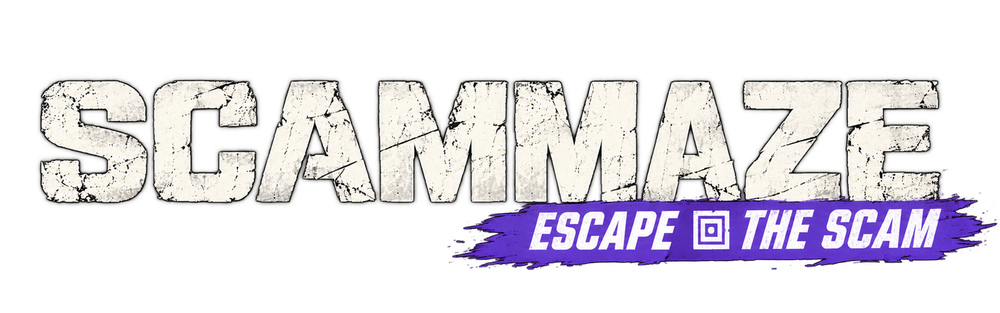
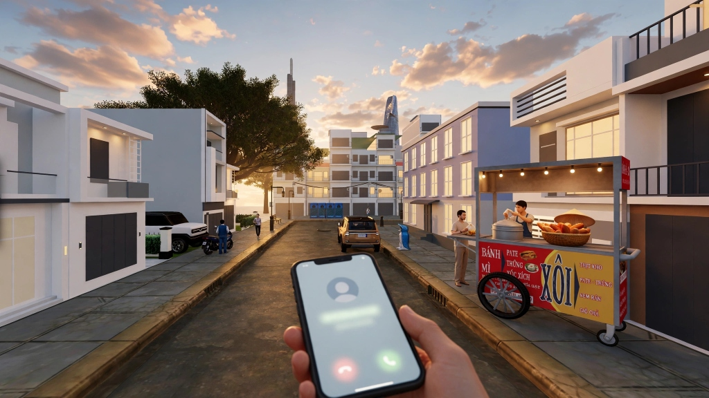
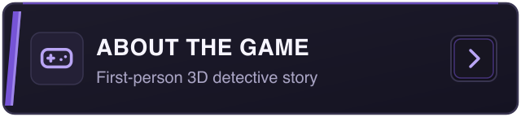
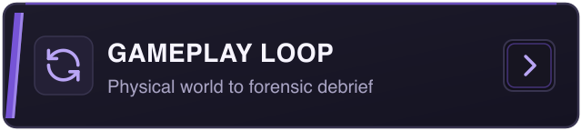
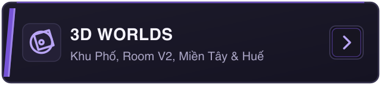
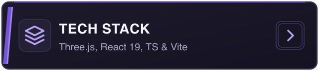
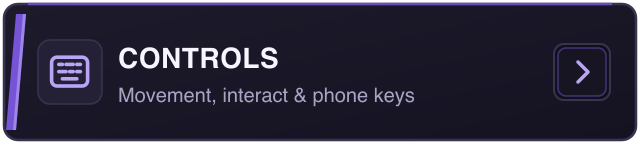
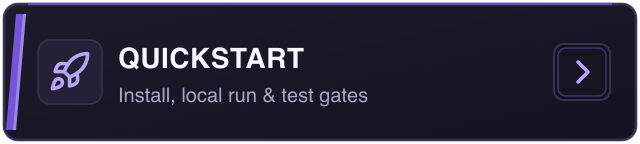
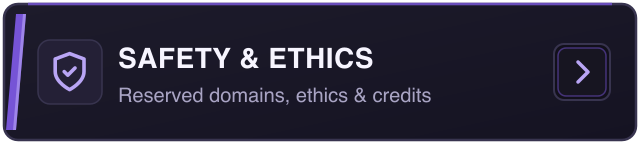

# SCAMMAZE

<p align="center">
  
</p>

<p align="center">
  <strong><em>"Trust no one. Question everything. Every scam starts on an ordinary day."</em></strong>
</p>

<p align="center">
  <a href="https://github.com/teehihi/scam-maze"></a>
  <a href="https://teehihi.github.io/scam-maze/"></a>
  
  
  
  
  
  
</p>

<p align="center">
  
</p>

<div align="center">

### 🧭 Quick Navigation

<p align="center">
  <a href="#about-the-game"></a>
  <a href="#core-gameplay-loop"></a>
  <a href="#scam-scenarios-and-vectors"></a>
</p>
<p align="center">
  <a href="#ui--systems-showcase"></a>
  <a href="#immersive-3d-worlds"></a>
  <a href="#technology-stack"></a>
</p>
<p align="center">
  <a href="#controls"></a>
  <a href="#getting-started"></a>
  <a href="#safety--ethics"></a>
</p>

</div>

---

<a id="about-the-game"></a>
## 🎮 About the Game

**SCAMMAZE** is an interactive, browser-based, first-person 3D narrative game built for **Kiroween 2026** (Frankenstein category).

In the real world, scams never look like multiple-choice quizzes or dry security warnings. They happen while you are walking down your street, relaxing in your room, or heading to work. 

Crucially, **scams do not only happen on phones**. While an in-game smartphone serves as one prominent digital interaction surface, SCAMMAZE is designed around a **multi-channel threat landscape**. Players experience diverse, evolving scam vectors that manifest across both digital devices (calls, SMS, emails, rogue portals) and physical in-person interactions (street recruiters, counterfeit goods, fraudulent flyers, impersonated service agents).

In **SCAMMAZE**, you live an ordinary life in a living fictional neighborhood. You must inspect both physical clues and digital signals to uncover contradictions, resist psychological manipulation, and make high-stakes decisions with lasting consequences.

* **Target Audience:** Young adults, university students, and everyday internet users in Vietnam and worldwide (equal weight).
* **Core North Star:** *A safe, living world where people learn to spot scams before facing them in real life.*
* **Full Product Definition:** [`docs/product/PRODUCT_POSITIONING.md`](docs/product/PRODUCT_POSITIONING.md)
* **Live Landing Portal:** [https://teehihi.github.io/scam-maze/](https://teehihi.github.io/scam-maze/)

---

<a id="core-gameplay-loop"></a>
## 🔄 Core Gameplay Loop

The detective loop connects the physical world with the digital world:

```
┌────────────────────────┐      ┌────────────────────────┐      ┌────────────────────────┐
│  1. Physical 3D World  │ ───► │ 2. Deception Trigger   │ ───► │ 3. Cross Investigation │
│  Explore neighborhood, │      │ Urgent call, street NPC│      │ Compare physical clues │
│  talk to local NPCs    │      │ SMS, or suspicious flyer│     │ against digital claims │
└────────────────────────┘      └────────────────────────┘      └────────────────────────┘
                                                                            │
                                                                            ▼
┌────────────────────────┐      ┌────────────────────────┐      ┌────────────────────────┐
│  6. Forensic Debrief   │ ◄─── │ 5. Consequence Branch  │ ◄─── │  4. Critical Decision  │
│  Full timeline review, │      │ Real-time simulated    │      │ Hang up, verify, stall,│
│  missed red flags & tips│     │ aftermath & story shift│      │ or comply with threat  │
└────────────────────────┘      └────────────────────────┘      └────────────────────────┘
```

1. **Physical World Exploration:** Walk freely in first person through a living 3D environment.
2. **Deception Trigger:** Encounter a suspicious situation through phone calls, street flyers, stranger requests, or SMS alerts.
3. **Cross-World Investigation:** Clues in the physical world contradict deceptive claims (e.g. an "undelivered package" message arrives when you already collected it from the locker downstairs; or an in-person flyer promises unrealistic wages).
4. **Critical Decision:** Confront psychological pressure (authority impersonation, fake urgency, guilt trips, too-good-to-be-true deals). Choose how to respond.
5. **Branching Consequences:** Choices trigger deterministic scenario outcomes that carry forward across chapters.
6. **Forensic Debrief:** Every chapter concludes with an educational breakdown detailing every red flag and where it could have been detected.

---

<a id="scam-scenarios-and-vectors"></a>
## 🕵️ Diverse Scam Scenarios & Vectors (Under Continuous Development)

SCAMMAZE is designed as an extensible platform for a wide spectrum of modern social engineering and fraud techniques. The scam vectors span digital channels, physical street life, and hybrid interactions:

| Scam Vector | Channel | Attack Mechanism & Scenario | Key Defensive Reflex |
|---|---|---|---|
| **The Urgent Voice Call (Vishing)** | Audio Call | Scammer impersonates a bank security officer or police authority demanding immediate verification under threat of legal action. | Never share OTPs; hang up and call official public hotline. |
| **The Missing Parcel (Smishing & Quishing)** | SMS / QR Code | Look-alike logistics tracking link claiming a parcel is held, asking for fee payment or identity upload. Physical parcel locker contradicts the claim. | Verify tracking code directly on the official courier portal. |
| **The Dream Job (Advance-Fee Recruitment)** | Café Flyer / Chat | High-paying remote tasks or job flyers placed around campus/cafés requiring an upfront "equipment deposit" or "training fee". | Legitimate employers never ask candidates to pay for employment. |
| **The Impossible Deal (Marketplace Fraud)** | Marketplace / In-Person | Second-hand electronics sale meeting on the street; seller insists on off-platform gift cards or fake escrow payment apps. | Inspect physical item carefully; refuse off-platform payment methods. |
| **The Family Emergency (Social Engineering)** | Voice / Message | Spoofed message or voice claiming a loved one is hospitalized or arrested, demanding instant money transfers. | Perform out-of-band verification by contacting family directly. |
| **Street Impersonation & Rogue Solicitations** | In-Person NPC | Shady street encounters, bogus donation drives, fake building utility inspectors requesting cash or personal data. | Demand official physical credentials; verify with building management. |

> *Status: only the first row is built so far, as Chapter 1 "The Urgent Call" (a fake bank-security call, then a second deception that looks like the fix). The other rows are planned scenarios ("The Missing Parcel" is deferred to a later chapter).*

---

<a id="ui--systems-showcase"></a>
## 📱 UI & Systems Showcase

The interface is engineered to seamlessly blend a 3D game engine with an authentic, interactive smartphone, in-world physical inspection, and forensic HUD:

### 1. In-Game Phone and Laptop (Digital Interaction Surfaces)
What exists in Chapter 1 today:
* **Incoming and active calls on a 3D phone:** an iPhone 17 Pro model (2D fallback when WebGL or the model is unavailable) with a status bar showing the in-game clock, a Dynamic Island, round Accept / Decline buttons, and in-call Mute, Speaker and Replay. The caller's lines appear as subtitles next to the phone; your replies are cards you pick with `1`-`3`, arrows or Enter.
* **Phone records:** call history, messages and voicemail, shown on the phone screen in the 3D view. Opening an item can reveal evidence.
* **Laptop:** a fictional bank app, a security notification, a compare view and a Review Security page, shown on the laptop screen in the 3D view. No text inputs, forms or live links.
* **Evidence journal:** collected evidence (combine 2 to 3 items to form deductions) and hints.
* All numbers and domains are fictional and plain text (reserved domains `.test`, `.example`, `.invalid`), and nothing is functional banking.

Planned, not built yet: a simulated mobile web browser and a parcel app.

### 1b. Prologue HUD: minimap, quests, conversations
In the New Game prologue (`/khupho`): a round **minimap** top-left (it turns with the camera, shows the street, houses and the tracked quest) with the in-game **clock** to its right; a **quest list** button under it (red mark for a new quest); the tracked quest shown as the **objective** with its distance. Pressing the quest (or `Q`) lights a **guide trail** on the ground to the person. The first quest, "Go see Auntie Mai", leads to the banh mi vendor, who has a quest icon above her head. Talking to her (`E`) opens a branching conversation (replies with `1`-`3`) about the scams going around: a fake bank call that asks for the OTP, a fake police call, and what they have in common. Voice for these lines is not recorded yet.

### 2. Main Menu & Cinematic 3D Scene
* **First-Person Street Camera:** Camera breathing, mouse parallax and a customizable Field of View (FOV).
* **Atmospheric Environment:** Low-poly city pack, animated moving vehicles, customizable sky dome with cloud drift.
* **Bilingual Switcher:** Instant runtime language toggle between **English** and **Tiếng Việt**.
* **Settings & Credits Modals:** Full control over graphics quality tiers, audio volume, and verified asset licenses.

### 3. In-World Inspection & Evidence Journal
* **Contextual prompts:** a prompt appears next to the item you aim at in the room (`[E]` to inspect or use).
* **Evidence Journal (`J`):** logs collected evidence and deductions; `H` toggles hints.
* **Dual-language subtitles and voice:** 88 generated voice clips (English and Vietnamese) with synchronized text.
* **Forensic debrief:** timeline of your decisions, missed clues and trust analysis at the end of the chapter.

---

<a id="immersive-3d-worlds"></a>
## 🗺️ Immersive 3D Worlds

SCAMMAZE features multiple custom-built 3D environments crafted with Three.js, React Three Fiber, and optimized low-poly assets:

| Environment | Route | Atmosphere & Narrative Setting |
|---|---|---|
| **Main Menu Street** | `/` | Cinematic dusk street scene with parallax camera, moving cars, and low-poly city backdrop. New Game and Continue start from here. |
| **Khu Phố** | `/khupho` | Vietnamese neighborhood with alleyways, shophouses, model residents and shop staff, a banh mi vendor, parked bikes and scooter traffic (including one reckless rider who weaves, pulls wheelies and revs his engine). House no. 59 leads to the player's room. |
| **Room V2** | `/roomv2` | The player's apartment room: warm desk lighting, rain, interactive items. In New Game it is the setting of Chapter 1. |
| **Street test** | `/testmove` | Street scene with a driveable Lexus GX 550 (first-person driving test). |
| **Miền Tây (Mekong Delta)** | `/mientay` | River waterways, wooden sampans, tropical greenery, floating market. |
| **Huế Heritage** | `/hue` | Citadel architecture, ancient bridges, royal tombs. |
| **UEH Campus** | `/ueh` | University campus with interactive vehicle exploration. |

**Chapter 1 "The Urgent Call"** has no route of its own. Start it with **New Game**: the neighborhood prologue in `/khupho` leads through the white doorway of house no. 59 into the room, where the chapter plays. **Continue** resumes a saved chapter in the room (save format v3).

---

<a id="technology-stack"></a>
## 🛠️ Technology Stack

SCAMMAZE is architected as an ultra-fast, modern **pnpm monorepo**:

| Layer | Technologies | Purpose |
|---|---|---|
| **Core 3D Engine** | Three.js r174 · React Three Fiber v9 · Drei v10 | First-person camera, scene rendering, lighting, and low-poly shaders |
| **Frontend Framework** | React 19 · Vite 8 · TypeScript 5.8 | High-performance client-side rendering with instant HMR |
| **Styling & Design** | Tailwind CSS v4 · Lucide React | Modern dark-mode UI with custom glassmorphism and keycap components |
| **Audio & Voice** | Web Audio API · Native HTML5 Audio | Dual-language voiced dialogue (EN/VI) with typed text synchronization |
| **Localization (i18n)** | i18next v27 · react-i18next v18 | Seamless bilingual support across all UI, subtitles, and world text |
| **State & Logic** | Pure TypeScript Deterministic Engine | Decoupled game state, branching consequences, and scenario rules |
| **Testing & Quality** | Vitest · TypeScript Workspace Check | 182 test files, 1,618 unit, component and property tests (no browser or end-to-end tests yet) |

---

<a id="controls"></a>
## ⌨️ Controls

| Action | Primary Key | Secondary Key |
|---|---|---|
| **Move** | `W` `A` `S` `D` | Arrow keys |
| **Sprint (street)** | `Shift` | — |
| **Look Around** | `Mouse Movement` | — |
| **Interact / Inspect** | `E` | `Space` (street), `Left Click` |
| **Answer / Decline a ringing phone (room)** | `F` / `R` | Round Accept / Decline buttons |
| **Pick a reply during a call** | `1`-`3` | Arrows + `Enter` |
| **Leave an inspected object (room)** | `Q` | `Backspace` |
| **Quest list / show the path to the tracked quest (street)** | `J` / `Q` | Click the quest name or the quest icon (free the cursor with `Ctrl`) |
| **Evidence Journal / Hints (room)** | `J` / `H` | — |
| **Free the mouse cursor** | `Ctrl` | — |
| **Pause / Main Menu** | `Escape` | — |
| **Street extras (`/khupho` prototype route only)** | `T` pause time · `R` rain · `M` mute · `G` tour | — |

---

<a id="getting-started"></a>
## 🚀 Getting Started

### Prerequisites
* **Node.js:** `>= 22.12.0`
* **pnpm:** `>= 10.0.0` (`corepack enable pnpm`)

### Installation & Run

```bash
# Clone the repository
git clone https://github.com/teehihi/scam-maze.git
cd scam-maze

# Install workspace dependencies
pnpm install

# Run the 3D Game & Worlds locally (Port 5174)
pnpm dev:game

# Run the Landing Page & Knowledge Hub locally (Port 5173)
pnpm dev:landing
```

### Verification & Quality Gates

```bash
# Run workspace-wide TypeScript verification
pnpm typecheck

# Run Vitest test suites (182 files, 1,618 tests)
pnpm test

# Build production artifacts for game and landing
pnpm build
```

---

<a id="project-structure"></a>
## 📁 Project Structure

```text
scam-maze/
├── apps/
│   ├── game/                         # 3D First-Person Game Application
│   │   ├── public/
│   │   │   ├── assets/branding/      # Official game logos & title banners
│   │   │   ├── assets/ui/            # Cinematic backgrounds & UI frames
│   │   │   ├── assets/3d/            # Optimized GLTF/GLB models & textures
│   │   │   └── audio/                # Voiced dialogue clips (EN & VI) & BGM
│   │   └── src/
│   │       ├── app/                  # Route manager & global settings state
│   │       ├── components/ui/        # Reusable UI (Modals, Buttons, LoadingScreen)
│   │       ├── features/
│   │       │   ├── chapter1/         # Chapter 1 UI: room layer, call/phone, laptop, journal, debrief
│   │       │   ├── prologue/         # New Game prologue: neighborhood to house no. 59 to the room
│   │       │   ├── menu/             # Main menu overlay, Settings, Credits
│   │       │   ├── khupho/           # Vietnamese neighborhood world engine
│   │       │   ├── roomv2/           # Room engine (host of Chapter 1)
│   │       │   ├── mientay/          # Mekong Delta world engine
│   │       │   ├── hue/              # Imperial Citadel world engine
│   │       │   ├── ueh/, testmove/   # Campus and street driving explorers
│   │       │   └── player/, vehicle/ # Shared first-person controller and vehicle audio
│   │       ├── game/narrative/       # Deterministic chapter core (reducer, evidence, debrief)
│   │       ├── game/world/           # Shared world lifecycle, stats & quality probe
│   │       ├── legacy/               # Parked street version of Chapter 1 (not maintained)
│   │       └── i18n/                 # Localization dictionaries (en / vi)
│   │
│   └── landing/                      # Marketing portal & Full-Page Knowledge Hub
│       ├── public/                   # Favicons, Halloween art, custom cursors
│       └── src/                      # Marketing landing sections & documentation
│
├── packages/
│   └── shared-types/                 # Framework-agnostic contracts & scenario types
│
├── docs/                             # Architecture, product positioning, and progress
├── .kiro/                            # Kiro steering rules, specs, and hooks
└── README.md                         # Main repository documentation
```

---

<a id="safety--ethics"></a>
## 🛡️ Safety & Ethics

SCAMMAZE is designed with strict cybersecurity education and safety guidelines:
* **Fictional Brands Only:** All organizations, companies, banks, and authorities are completely fictitious.
* **Reserved Domains Only:** All digital URLs strictly utilize RFC-reserved domains (`.test`, `.example`, `.invalid`). Live links are never generated.
* **No Real Credentials or OTPs:** The game never asks for, accepts, or transmits real usernames, passwords, bank account numbers, or authentication codes.
* **Defensive Reflexes:** The educational objective is strictly defensive: identifying psychological manipulation, verifying out-of-band, checking domain strings, and rejecting urgency traps.
* **Offline-First Deterministic Core:** All gameplay logic, choices, and consequences execute entirely inside the client browser.

---

<a id="license--credits"></a>
## 📜 License & Credits

### Source Code
The source code is licensed under the [MIT License](LICENSE).

### Verified 3D Asset Attribution
Detailed licensing and provenance are maintained in [THIRD_PARTY_NOTICES.md](THIRD_PARTY_NOTICES.md):
* **Low Poly City Asset Pack:** By Calipo (Sketchfab, CC-BY 4.0).
* **Low Poly Cars Pack:** By matisosanimation (Sketchfab, CC-BY 4.0).

### Original Soundtrack & Audio
* **Original Soundtrack (`apps/game/public/reality/`):** Composed by **Lê Quốc Khánh (Men Le)**. All rights reserved (not covered by the MIT license).
* **Voice Acting Narration:** Recorded specifically for SCAMMAZE bilingual chapters.

---

<p align="center">
  Built with ❤️ for <strong>Kiroween 2026</strong>.
</p>
