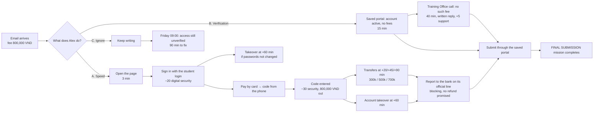
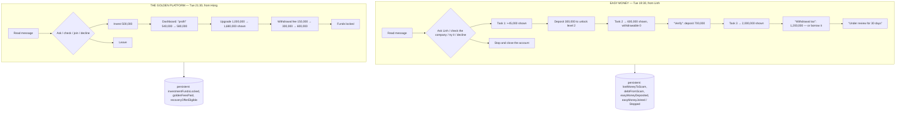
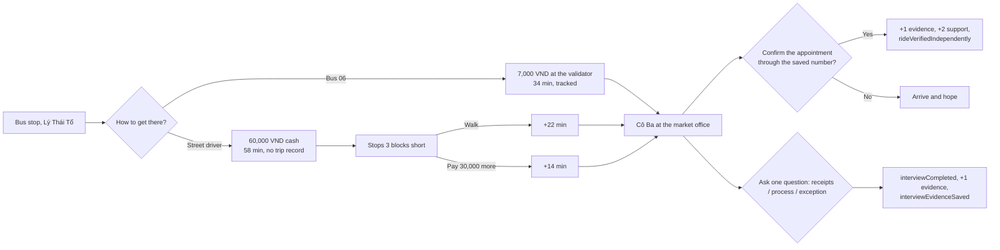

# Chapter 1 — “LAST SUBMISSION: 72 GIỜ CUỐI”: story and player journey

> **Status: `IMPLEMENTED` for Mission 01, Mission 02 and the two optional offers; the later missions and
> the chapter ending are `PLANNED`.**
>
> This document describes the **room version** of Chapter 1 that the game actually routes to
> (`game/narrative/activeScenario.ts` → `chapter1/lastSubmission.ts`). The older street chapter
> (“The Urgent Call: The False Victory”) is `DEPRECATED`; see
> [CHAPTER_01_THE_URGENT_CALL.md](CHAPTER_01_THE_URGENT_CALL.md).
>
> The visual, always-current version of this map is the `/journey` page in the game
> (`features/journey/JourneyMapPage.tsx`). It is generated from the same scenario data at runtime, so
> it cannot drift from the build. This document explains the same thing in prose and diagrams, and
> adds the parts a reader needs but the page does not judge: what is missing, and why.

---

## 1. Read this in three passes

| Pass | Question | Where |
|---|---|---|
| 1. Rules | What can happen, and what is forbidden? | `game/narrative/types.ts`, `reducer.ts`, `world.ts`, `conditions.ts`, `resources.ts` |
| 2. Content | What is the story made of? | `game/narrative/chapter1/*` (data only) |
| 3. Presentation | How does the player touch it? | `features/chapter1/**`, `features/journey/**` |

The rule that keeps the three apart: **the narrative core is pure TypeScript**. It imports no React,
Three.js, Rapier, Zustand, Dexie or i18n (`game/narrative/boundaries.test.ts` enforces it). Time,
money, flags, missions and events are decided there. The 3D room, the laptop and the phone only send
`CoreAction`s and draw what comes back.

```
player input ──► CoreAction ──► chapterReducer(state, action, scenario) ──► new ChapterState
                                     │                                        │
                                     ├─ settleWorld(): clock, events,         ├─ selectors → HUD, task list,
                                     │  mission opens, deadlines, paths       │  laptop apps, phone apps
                                     ├─ applyBeats(): scripted records        └─ saveGame: actions replayed
                                     └─ runObjectiveManager()
```

One real second is one simulated minute while the player is free in the room
(`msPerGameMinute: 1000`). The clock stops under an overlay and while the bus drives. Saves store
the accepted actions, not the state, and a save that does not replay is rejected.

---

## 2. Piece by piece: which file decides what

| File | Decides | Never does |
|---|---|---|
| `game/narrative/resources.ts` | The 72-hour budget, the seven resources, all persistent flags, the start state, the wall clock | Change after start |
| `game/narrative/world.ts` | When a mission opens, when an event fires, when a deadline fails it, which mission path is current | Write dialogue |
| `game/narrative/reducer.ts` | 21 action kinds in, new state out; outcome lock; event log | Read the wall clock or randomness |
| `game/narrative/fatigue.ts` | What thesis work costs in fatigue, what sleep restores, how much slower work gets | End the chapter |
| `game/narrative/thesisSession.ts` | Writing Mode’s warm-up → flow → burnout block, interruptions saved and resumed | Grant progress without typing |
| `chapter1/mission01.ts` | Mission 01 (fake clearance fee), SECURITY BREACH, the Friday late checks, the single thesis task | Judge the player |
| `chapter1/mission01Offers.ts` | EASY MONEY and THE GOLDEN PLATFORM, their deposits, shown balances and pressure messages | Refund anything |
| `chapter1/mission02.ts` | THE RIDE: Bus 06 vs the unregistered driver, the Cô Ba interview, the 12:30 window | Teleport the 3D player (it records a story location) |
| `chapter1/parcel.ts` | The parcel thread: the paper slip, the fake redelivery page, the courier lookup | Say a message is a scam |
| `chapter1/storyCast.ts` | The ten story NPCs, their missions, spatial anchors, schedules and street dialogue | Change chapter state directly |
| `features/chapter1/room/RoomChapterLayer.tsx` | The playable host: intro, overlay stack, HUD, clock, checkpoints, the room bridge | Contain story rules |
| `features/chapter1/room/desktop/LaptopDesktop.tsx` | Mail, Files, Browser (UEH sites), Banking, Calendar, Thesis, Writing Mode | Invent money or flags |
| `features/chapter1/hud/ChapterStatusHud.tsx` | The map disc, three status bars, the clock, cash | Write anything |
| `features/chapter1/room/RoomEndingLayer.tsx` | The ending and debrief screens **when an outcome exists** | Create an outcome for a chapter without decisions |
| `game/narrative/chapter1/journey.ts` | The `/journey` model: missions, paths, steps, tracks, flags, cast, code map | Duplicate story text |

---

## 3. The story

**Premise** (authored in `i18n/locales/*/chapter1/hud.ts`, `intro.last.*`): Alex, 23, is an
international final-year student in Ho Chi Minh City. The thesis is 60% done. 72 hours remain
(Tuesday 17:00 → Friday 17:00). Money is tight, the dorm term is ending, no steady job. Offers of
help will arrive; Alex decides what to check, what to trust and what to skip.

The opening is Alex’s own recorded voice (ten cues in `features/chapter1/voice/mission01Voice.ts`)
with cinematic subtitles; one line reacts to each thing the player sees or does, never to a timer.

**The five-mission arc of the brief** (only the first two are data):

| # | Time | Working title | Scam mechanism | Status |
|---|---|---|---|---|
| 01 | Tue 17:00 | THE MISSING ACCESS | Fake university “clearance fee”, then a login+code takeover | `IMPLEMENTED` (+ SECURITY BREACH, FINAL SUBMISSION, two optional offers) |
| 02 | Wed 11:00 | THE RIDE / THE LAST INTERVIEW | Unregistered cash ride to a real appointment; fake redelivery fee | `IMPLEMENTED` (ride + interview + parcel slice) |
| 03 | Thu 08:00 | — (money and housing) | Deposit and rent pressure, a short-term “project” | `PLANNED` |
| 04 | Thu 20:00 | — (an online acquaintance) | Maya, known only online | `PLANNED` |
| 05 | Fri 14:00 | — (the recovery offer) | A “recovery service” that refers to the earlier loss | `PLANNED` |
| — | Fri 17:00 | FINAL SUBMISSION | The deadline itself | `IMPLEMENTED` (mission), no ending (`PLANNED`) |

**Cast** (all of it in `storyCast.ts`; each profile carries its mission numbers, a street anchor or
phone-only, a schedule and branching dialogue): Minh (thesis partner, M01–M05), Linh (other faculty,
M01 — EASY MONEY), Hùng (Minh’s cousin’s friend, M01 — THE GOLDEN PLATFORM), the street driver (M02),
Cô Ba (District 5 interviewee, M02), Mr. Tuấn (boarding-house landlord, M03), Ms. Vy (short-term
project recruiter, M03), Maya (online acquaintance, M04), Dr. Nguyễn (supervisor, M01–M05), the
Training Office (official channel, M01 and M05).

---

## 4. The 72-hour clock

| Minute | Clock | What happens | Source |
|---|---|---|---|
| 0 | Tue 17:00 | Chapter starts; Mission 01 opens; FINAL SUBMISSION opens with the whole 72 h as its deadline | `mission01.ts` |
| 10 | Tue 17:10 | The “Graduation Clearance” email arrives | `mail.clearance` |
| 150 | Tue 19:30 | EASY MONEY offer from Linh (optional) | `mission01Offers.ts` |
| 270 | Tue 21:30 | THE GOLDEN PLATFORM offer from Hùng (optional) | `mission01Offers.ts` |
| 780 | Wed 06:00 | Mission 01 deadline: if the draft is not typed, Alex works through the night (−180 min, +25 fatigue) | `MISSION_01_CONFIG.draftDeadlineMinute` |
| 900 | Wed 08:00 | Parcel message from “Tốc Hành 24” (22,000 VND “redelivery fee”) | `parcel.ts` |
| 1050 | Wed 10:30 | Optional: Minh asks how Alex is getting to District 5 | `m02.minh-warning` |
| 1080 | Wed 11:00 | Mission 02 opens; travel to District 5 is allowed | `mission02.ts` |
| 1110–1170 | Wed 11:30–12:30 | Cô Ba’s interview window | `cal.m02-interview` |
| 1230 | Wed 13:30 | The parcel counter closes; the parcel stays there | `m02.counter-closes` |
| 1260 | Wed 14:00 | Mission 02 deadline: no interview ⇒ `interviewMissed` | `mission02.ts` |
| 3840 | Fri 09:00 | If access was never verified: “submission access is still unverified” (90 min to fix). If the account is still compromised: “account is still locked” (120 min to fix) | `mission01.ts` |
| 4320 | Fri 17:00 | FINAL SUBMISSION deadline: no receipt ⇒ `submissionDeadlineMissed` | `mission01.ts` |

Timed consequences, not timers: an unauthorized transfer fires at exactly +20/+45/+90 minutes after
the code is entered, but a bank report that finished earlier cancels it; money can only leave once
and only what is there; nothing is ever refunded.

---

## 5. The player journey as it plays today

### 5.1 Boot → room

Main menu → New Game → chapter loading (real byte progress) → the 3D apartment. There is no
neighborhood walk any more (`prologueGate.ts`). The intro overlay opens the chapter, then the HUD
takes over: map disc with digital security / support network / fatigue, the clock, cash, and the task
button. Controls: **WASD** move, **E** interact, **P** phone, **J** journal, **K** schedule, **T** task
list, **Esc** pause.

The clock only runs while the room is free. Opening the laptop, the phone, the journal, the schedule
or the pause menu freezes it.

### 5.2 The thesis spine

The draft is one task (`draft.final`): type two sentences in Writing Mode, 60 simulated minutes,
+7% thesis (60% → 67%). Writing Mode is a real typing surface with a warm-up → flow → burnout curve;
interruptions are saved and resumable. Fatigue slows typing, sleep and naps lower it, and the night
checks at 03:00 punish a missed night.

Mission 01 completes when that task is done — not when the email is handled. The email question can
still return on Friday morning if it was ignored.

### 5.3 Mission 01 — three honest ways through



- The page never says it is fake. Its order is the tell: it asks for a login **before** it asks for
  money, and the bank’s own SMS says what the code approves and that nobody may ask for it.
- SECURITY BREACH opens only if the login was entered. It completes with changed passwords **and**
  either no code given or a bank report.
- Every step costs simulated minutes; the ledger keeps every amount; the bank can block, never
  refund.

### 5.4 Two optional offers, both “too easy”



The shown balance is never money. Nothing says “this is a scam”; the player reads the figures, the
missing company registration, the withdrawal that never happens. Saving the records sets
`scamEvidenceSaved`, which the recovery offer of Mission 05 is meant to read.

### 5.5 Wednesday — the day the story opens up

1. **08:00** — a courier message asks 22,000 VND for a “redelivery”. On the desk there is a paper
   slip: tracking code, the Chợ Lớn counter, and the line “Redelivery at the counter is free.” The
   courier app lookup by code (4 min) says no fee is recorded and the counter closes at 13:30; the
   lookup by phone number (8 min) says the sender pays.
2. **11:30** — “the final interview”. Two ways to District 5, and the choice is the lesson:



3. **12:30** — the window closes. **14:00** — the mission fails without an interview, but the day is
   not over: arriving late still allows asking Cô Ba to reschedule at the market office. No “game
   over” screen exists anywhere in this chapter.

### 5.6 Friday — the deadline that is a system

The saved portal only submits when **all** of these hold: the draft is typed, access was verified,
and the account is not compromised. Otherwise the button exists but the mission cannot complete, and
at 09:00 the game tells the player which of the three is missing — with a real cost in minutes, not a
fail screen. Missing 17:00 sets `submissionDeadlineMissed` and nothing else happens: the run keeps
going.

---

## 6. State and consequences

| Resource | Start | Notes |
|---|---|---|
| Time left | 4320 min (72 h) | Never negative |
| Thesis | 60% | Free work stops at 90%; the last 10% needs tasks |
| Cash | 2,500,000 VND | Can go into debt |
| Digital security | 100 | Login −20, code −30, takeover −20, transfers −5, password change +15 |
| Support network | 50 | Training Office +5, Cô Ba confirmation +2 |
| Evidence | 0 | A verified fact, not a screenshot count |
| Fatigue | 20 | Slows thesis work; sleep 360 min restores 50 |

Persistent flags: **37 of 45 are written by today’s content**, **8 are reserved** for the later
missions — `backupSecured`, `safeHousing`, `identityDocumentsExposed`, `housingDepositLost`,
`minhTrustsAlex`, `researchSavedChannelIncluded`, `draftSourcesChecked`, `findingsReconciled`.
`schoolFeeClaimContradicted` was in that list until this change: the Training Office and the saved
portal both contradict the “clearance fee”, so both now write the flag the later missions read.

That 37/8 split is the honest status line of the chapter: the systems for three more missions are
declared and waiting.

---

## 7. What is not built (and what that costs)

| Gap | Impact | Where to fix |
|---|---|---|
| **No ending and no debrief** | After a successful submission nothing concludes the run: `scenario.decisions`, `endings` and `debrief` are empty, so no outcome is ever set and `RoomEndingLayer` never opens. The chapter has a deadline but no closing beat. | `chapter1/lastSubmission.ts` + a new debrief wording for this story |
| Missions 03–05 | Nine reserved flags and four cast members have nothing to do; the 72-hour arc stops on Wednesday night | new `mission03.ts`… with the same data rules |
| Two calendar entries at 11:30 | `cal.interview` (Mission 01) and `cal.m02-interview` (Mission 02) describe the same appointment; the Calendar app shows both | merge them in `mission01.ts` / `mission02.ts` (a test pins the current list) |
| `intro.last.*` copy unused | The three premises paragraphs are authored but the overlay receives an empty line; the opening is voice + captions only | `RoomChapterLayer.tsx` intro lines, if the design wants text there |
| Evidence is a number | There is no evidence inventory; the HUD does not show it | design decision, not a bug |
| Parked story still shipped | `chapter1/scenario.ts` (The Urgent Call), its acts, decisions and endings stay in the bundle for tests | eventual removal once the engine fixtures move |
| `/journey` has no menu entry | A dev URL only (`/journey`) | optional menu or settings link |

---

## 8. The visual map: `/journey`

```
pnpm dev:game        → http://localhost:5174/journey
```

The page (`features/journey/JourneyMapPage.tsx`) renders `buildScenarioJourney(scenario, locale)`:

- the **72-hour timeline**: day bands, one bar per mission from open to deadline, appointments, event
  dots, planned missions as dashed markers;
- **mission cards** with every path in priority order, the objective text, the steps (with their
  device/app), and the `onFail` effects;
- **planned missions** M03–M05 with their clock time, cast (from the cast registry) and the flags
  they will read;
- **cast**, **device items per app**, the interactables, the thesis task;
- the **start state** of the seven resources;
- **flags**: written now vs reserved;
- the **code map**: file → what it owns.

Because the page and the tests read the same scenario, adding a mission adds a card; removing one
removes it. `journey.test.ts` also checks that every path in the code map is a real file.

---

## 9. Verification of this work

Run in `apps/game` after the change:

```bash
./node_modules/.bin/vitest run src/game/narrative/chapter1/journey.test.ts \
  src/features/journey/JourneyMapPage.test.tsx \
  src/app/App.chapter.test.tsx \
  src/game/clock/mission01.test.ts src/game/clock/mission01.complete.test.ts
./node_modules/.bin/tsc -p tsconfig.app.json --noEmit
```

Results: all of the above pass (17 + 6 + 11 + 42 + 22 tests) and the app typecheck is clean. The
full workspace suite was not run for this document.
