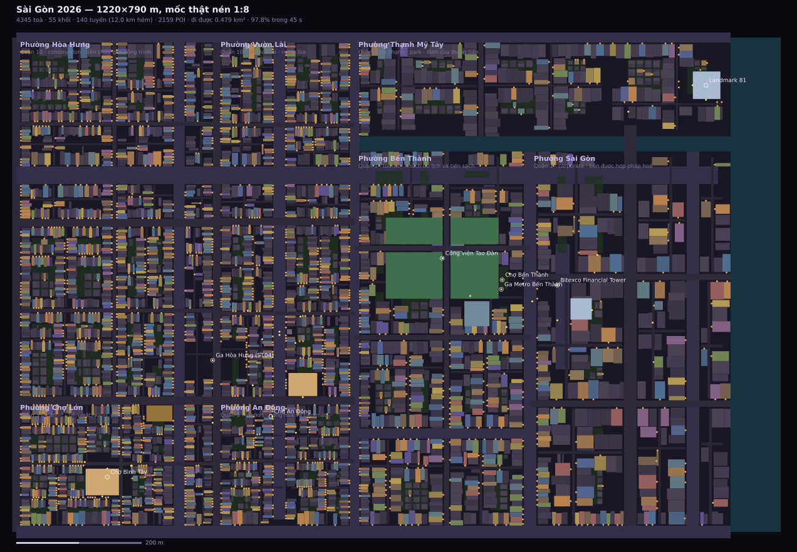

# Bản đồ thành phố 1:8 — Sài Gòn 2026

Tài liệu này là bản kiểm toán của **bản đồ thành phố dùng trong game** (`cityGen.ts`), khác với bản
kiểm toán vùng mở cũ trong [`MAP_AUDIT.md`](MAP_AUDIT.md). Ở đây thành phố **được sinh ra từ dữ liệu
quy hoạch có kiểu** (`cityPlan.ts`) chứ không phải vẽ tay từng hình chữ nhật, và **mỗi lần sinh đều
phải qua một bài đo độc lập** trước khi được coi là xong.

```bash
node apps/game/scripts/city-audit.ts            # đo + xuất SVG/PNG/JSON, exit 1 nếu vi phạm cổng
node apps/game/scripts/city-audit.ts --no-png   # chỉ đo (nhanh hơn)
node apps/game/scripts/city-render.ts           # 6 ảnh 3D (không cần trình duyệt)
node apps/game/scripts/city-render.ts --view=avenue --no-png   # một ảnh, không xuất PNG
npx vitest run apps/game/src/features/citymap/cityGen.test.ts  # 14 test khoá hình dạng
```

Đầu ra:

- `docs/product/audit/city-plan.png`, `city-iso.png` — ảnh phẳng + ảnh trục đo, dựng từ chính dữ liệu
  va chạm.
- `docs/product/audit/city-metrics.json` — toàn bộ số đo.
- `docs/product/audit/city-{axon,hem,avenue,market,room,roof}.{svg,png}` — 6 ảnh 3D §1b.

## 0. Vì sao có bài kiểm toán riêng

Bản đồ tự sinh rất dễ "trông ổn" mà vẫn hỏng: một khối bị bọc kín thì người chơi không vào được, một
dãy mặt phố bị xoá thì cả con phố thành tường trống, một lô nhà thò xuống sông thì va vào nước. Những
lỗi đó **không nhìn thấy bằng mắt ở tỉ lệ 1:8** nhưng người chơi sẽ gặp trong 30 giây đầu.

Nên `city-audit.ts` là một chương trình **độc lập**: nó có lưới raster riêng, BFS riêng, và **không
import hàm đo nào của generator**. Nó đọc `generateCity()` như người chơi đọc — qua `isWalkable`,
`cellAt`, hình học toà nhà — rồi tự tính lại mọi con số. Nếu generator tự khen mình thì bài đo này
không tin.

## 1a. Ảnh phẳng — bản đồ đo được



Đọc ảnh:

- **Khung xám** = 1.220 × 790 m (0,96 km²), tỉ lệ 1:8 — một mét trong game là 8 m ngoài đời.
- **Ô màu** = toà nhà, màu theo loại (nhà ở, tiệm, kho, khách sạn, văn phòng…), cao độ theo số tầng.
- **Dải xanh đậm bên phải** = sông Sài Gòn (x 720–800); **dải ngang phía trên** = kênh Thị Nghè
  (z −312…−288). Cầu Thị Nghè (x = 560, rộng 20 m) bắc qua kênh và **đi được trên mặt cầu**.
- **Mảng xanh lá** = công viên Tao Đàn, **cắt theo khối** nên bốn mảng xanh nằm giữa phố chứ không
  nuốt mất phố.
- **Khối màu vàng đất** = chợ Bình Tây, chợ Bến Thành, ga Hòa Hưng; **khối xám lớn** = Landmark 81,
  Bitexco, Vietcombank Tower.
- **Chấm vàng nhỏ** = vật thể vỉa hè (xe máy, cây, thùng rác, đèn, sạp hàng, đồ phơi).

## 1b. Ảnh 3D — sáu khung hình để *nhìn*, không chỉ để đo

`city-render.ts` là renderer phần mềm: camera phối cảnh có cắt gần, sắp xếp painter, đổ bóng một
nguồn, và xuất SVG rồi raster hoá bằng `sharp`. Không cần Chromium, không cần WebGL — nên **nhìn
được thành phố ngay trong sandbox**, không phải chờ máy owner.

| Ảnh | Trả lời câu hỏi |
|---|---|
| [`city-axon.png`](audit/city-axon.png) | Cả thành phố có đọc ra Sài Gòn không: mật độ, mạng phố, bốn cụm cao tầng, tên phường. |
| [`city-hem.png`](audit/city-hem.png) | Hẻm 2,7 m có thật sự là hẻm: tường hai bên, dây điện, biển hiệu, không lỗ hổng. |
| [`city-avenue.png`](audit/city-avenue.png) | Đại lộ 20 m: lòng đường + vạch tim + hai dãy mặt phố + cây. |
| [`city-market.png`](audit/city-market.png) | Chợ Bến Thành: sạp, mái, hàng quán, có nhìn thấy chợ từ chỗ đứng không. |
| [`city-room.png`](audit/city-room.png) | **Bước ra khỏi phòng 6.07 thì thấy gì** — ảnh này dùng đúng `city.start` của game. |
| [`city-roof.png`](audit/city-roof.png) | Mái nhà nhìn xuống mạng hẻm: độ dày khối, sân chung, bồn nước. |

Sửa thêm trong vòng "làm cho đẹp": **bỏ đế đen** (nay đất chạy ra ngoài khung, chỉ còn gờ mảnh),
**Landmark 81 là cụm ba tháp so le** (461 m + 305 + 231 m) thay vì một hộp trắng, **mái chợ là tôn rỉ
có gân** thay vì một tấm bê tông xám đọc ra "bãi đỗ xe", và **đường tối hơn mái / vỉa hè sáng hơn
mái** để mạng phố đọc được từ trên cao.

Hai lỗi renderer đã sửa trong vòng này, ghi lại để không lặp:

- **Camera đặt trong vật thể.** Ảnh "hẻm" từng có nửa khung hình là một tấm vải phơi ngay trước ống
  kính, ảnh "chợ" có một bức tường chiếm một phần ba khung. Nay mọi camera tầm mắt đi qua `nudge()`:
  đòi `isWalkable`, cách tường ≥1,2 m, cách vật thể ≥1,3 m, và ảnh chợ còn đòi **tia nhìn tới chợ
  phải trống**.
- **Mặt khuất nắng gần như đen.** Sàn sáng nâng 0,20 → 0,30 và thành phần trời 0,16 → 0,20; trước đó
  mặt quay vào camera mất hết khối.

## 2. Số đo (lần chạy cuối, tái lập được)

| Chỉ số | Giá trị | Cổng |
|---|---|---|
| Khung / diện tích đất | 1.220 × 790 m = **0,96 km²** | — |
| Đi được | **477.588 m² = 0,4776 km²** (54 % đất) | 0,30–0,52 km² (xem §3a) |
| Vùng rời rạc | **1** · lớn nhất 100 % · từ phòng tới được 100 % | 1 vùng, ≥99 % |
| Mái che | **0,409 km² = 46,1 % đất** · **4.327 toà** · trung vị 4 tầng | 42–68 % (xem §3a) |
| Khối / sân chung | **55 khối · 108 sân** | — |
| Đường | **27,1 km** (12,0 km hẻm) = **28,1 km/km²** | 24–70 km/km² |
| **Tim đường trống** | **100 %** · 0 tuyến bị chặn | **100 %** |
| **Mốc thật có toà** | **9 / 9** (Bitexco 262 m · Landmark 461 m trên đế 84 m · 3 chợ · 2 ga · Tao Đàn 4 mảng · phòng 6.07) | **9 / 9** |
| Mặt tiền (trung vị theo tuyến) | **14,6 đơn vị + 7,4 chức năng / 100 m** · p10 5,6 · **49,4 % mét mặt tiền có nhà** | xem §3b |
| Mặt tiền theo phường | nhà ở **16,9 + 7,9** · chợ **18,0 + 9,4** · đang xây **16,0 + 8,5** · khách sạn **9,7 + 5,0** · công viên **9,1 + 2,3** · văn phòng **6,1 + 2,5** | ≥12 + ≥6 cho nhà ở/chợ/đang xây; ≥3 + sàn 3 cho đại lộ tháp/khách sạn |
| Đoạn mặt tiền chết dài nhất | **610 m** (Cầu Thị Nghè — đoạn cầu vắt qua kênh) | báo cáo, không phải cổng — xem §3b |
| POI | **2.161** (32 venue + 2.129 cửa hàng) = **4.520 POI/km²** · 0 POI kẹt | 0 POI kẹt |
| Đi bộ 45 s tới POI | **97,8 %** diện tích · xa nhất **98 m** | ≥80 % |
| Chi tiết vỉa hè | **8.154 vật thể = 30,1 / 100 m** đường | ≥25 |
| Cao nhất | 461 m (Landmark 81) | ≥300 m |
| Thời gian sinh | **3,9 s** | — |

Số thô trong `docs/product/audit/city-metrics.json`; ảnh phẳng và ảnh trục đo trong cùng thư mục.

## 3. Những chỗ phải nói thẳng (đo được, không giấu)

**(a) Hai cổng đã được nới *vì cách đo cũ sai*, không phải vì kết quả xấu.**

Bản đồ có một bất biến mới: **không toà nhà nào được đè lên lòng đường** (§4, dòng đầu). Trước bất
biến đó, ~890 lô nhà nằm chồng lên lòng đường/hẻm của tuyến khác. Chúng vừa làm bẩn chỉ số "mặt tiền
có nhà" (một toà nằm giữa lòng đại lộ vẫn được tính là nhà mặt phố), vừa **ăn mất diện tích đi được**:
phần đất dưới chân chúng bị raster đánh dấu là vật cản, dù thực địa đó là đường.

Nay số đo đổi theo hướng trung thực hơn:

- đi được **0,3834 → 0,4776 km²**: phần tăng là đất đường bộ vốn bị nhà chiếm chỗ, không phải thành
  phố mới mở rộng. Trần cổng 0,43 → **0,52** vì lý do đó, sàn 0,30 giữ nguyên.
- mái che **56,7 % → 46,1 %**: cùng một lý do. Sàn 45 → **42**.
- "mét mặt tiền có nhà" **61,3 % → 49,4 %**: con số cũ bị thổi lên bởi đúng những lô nằm trong lòng
  đường. Cổng 55 → **45**.

Điều **không** đổi: hình dạng thành phố không mất phố nào (27,9 → 27,1 km đường, 55 khối), và mọi
cổng về tính đi lại vẫn đạt: 1 vùng, 100 % tới được từ phòng, 0 POI kẹt, 97,8 % trong 45 s.

**(b) "Mặt tiền chết 47,7 %" là số báo cáo, không phải số để kết luận.** Khi một con phố và một con
hẻm chạy song song cách nhau vài mét, mỗi toà nhà chỉ thuộc về **một** tuyến (tuyến gần hơn); tuyến
còn lại bị tính là "trống" dù thực địa không trống. Đoạn "chết" dài nhất (610 m, Cầu Thị Nghè) là
đoạn cầu vắt qua kênh — hai bên là nước, không thể có nhà. Cổng vì vậy là **tỉ lệ mét mặt tiền có
nhà (≥45 %)**, còn đoạn dài nhất chỉ để soi.

Mẫu số của mọi chỉ số mặt tiền là **đoạn tường phố**, không phải chiều dài hình học của tuyến: mỗi
bên tuyến lấy hợp các khoảng `front.intervals` (nở 6 m), bỏ bên có tường <30 m rồi mới chia. Cách cũ
(hai lần chiều dài tuyến) từng khiến một tuyến đi qua ngã tư bị tính là 57 % "ngã tư" — con số vô
nghĩa.

**(c) POI được kiểm bằng hình học chính xác, không bằng lưới.** Lưới raster 0,5 m có ích để đo diện
tích và BFS, nhưng một POI đứng cách mặt tiền 1,1 m có thể rơi vào ô mà toà nhà phủ một phần. Lấy
lưới làm chuẩn sẽ báo lỗi ma. `isWalkable()` là chuẩn; lệch lưới chỉ được đếm là dung sai một ô.

**(d) Điểm xuất phát từng nằm giữa đại lộ.** Mốc `room` chiếu ra đúng gốc bản đồ, mà trục Lý Thái Tổ
lại đi qua gốc — nhà của người chơi mọc lên giữa lòng đại lộ 20 m. Nay nhà trượt ra lô trống gần
nhất (x 11…19), và `city.start` là **cửa trước** (10,4; 0), cách tâm nhà 4,6 m, đứng được cả theo
hình học lẫn theo lưới. Test `điểm xuất phát không nằm trong tường` khoá điều này.

**(e) Sáu trong chín mốc thật từng KHÔNG có toà nào trên bản đồ** — và không cổng nào bắt được.
Bitexco (262 m), chợ Bến Thành, chợ Bình Tây, chợ An Đông và cả hai ga metro đều biến mất: hình chữ
nhật của mốc (66–90 m) đè lên lòng đường nên `addBuilding` từ chối, `clearArea` thì đã dọn sạch khối
trước đó — kết quả là một **ô trống** đúng chỗ đáng lẽ có chợ. Chợ Bến Thành còn bị ga Metro Bến
Thành (đặt sau, sát bên) xoá sạch vì `clearArea` dọn cả toà mốc.

Đã sửa: mốc **không bao giờ bị bỏ** (thu nhỏ dần tới khi vừa lô trống), chợ lớn **cắt theo khối** như
công viên, và `clearArea` **không đụng vào toà mốc**. Cổng mới: `anchorsMissing` phải rỗng và **mỗi
mốc phải có ≥1 toà**. Đây là loại lỗi mà mọi con số tổng hợp đều bỏ qua — chỉ ảnh chụp mới lộ ra.

## 3d. Công trình, không phải khối hộp

Ảnh dựng đầu tiên đọc ra "các khối hình học xếp cạnh nhau": mỗi toà là một hộp chữ nhật dựng
đứng, tô một màu phẳng, cửa sổ là những ô tối. Bốn thứ đã thay đổi hẳn điều đó:

**1. Toà nhà là nhiều khối, không phải một.** Tháp văn phòng = bệ thấp (rộng bằng lô) + thân
**lăng trụ vát tám cạnh** thụt dần theo hai cấp + hộp kỹ thuật trên đỉnh. Nhà ống = khối thân +
**mái ngói dốc hai mái** có hàng ngói + **tum thang** + bồn inox. Chợ = nhà lớn + mái tôn gân +
hàng cửa gió. Độ thụt của tháp **co theo bề rộng lô**: tháp 9 m thụt 20 % thành cây kim — đó
chính là thứ trông "máy sinh" nhất trong bản dựng đầu.

**2. Mặt đứng có chiều sâu.** Tường chia chín dải dọc: chân tường tối (đất, ẩm, bóng hắt), lên
cao sáng dần, sát mái ngả xanh trời. Cửa hàng tầng trệt là **cửa cuốn 3–6 tấm** + tấm biển +
**biển hiệu nhô vuông góc** 0,85 m. Tháp kính có **lưới mullion dọc + dải sàn ngang**.

**3. Thành phố có bóng.** Bóng đổ trước đây chỉ vẽ ở ảnh trên cao; ở tầm mắt mặt đường và mặt
tường sáng đều nhau nên cả cảnh ra hình phẳng. Nay bóng vẽ ở mọi khung (đậm 0,52 trên cao, 0,34
ở tầm mắt).

**4. Không phải lô nào cũng là tháp.** Khu văn phòng có **34 % lô là nhà 3–5 tầng** chen giữa
(`lowRise` trong `GRID`), khách sạn 37 %, công viên 30 %. Phố Lê Lợi thật có nhà ống 4 tầng nằm
cạnh tháp 20 tầng; cả dãy cùng chiều cao thì ảnh trên cao đọc ra rừng khối giống nhau.

Hai lỗi nền đã sửa trong cùng vòng: **đất ngoài khung chưa từng được vẽ** (một tứ giác 5,8 km có
đỉnh nằm sau camera bị cắt thành đa giác tự cắt rồi biến mất ⇒ thành phố lơ lửng trên trời), nay
chia thành lưới 64×64 ô; và **đế Landmark 81 là 44 m cho tháp 461 m** (tỉ lệ 10:1, đọc ra cái ống
khói) — nay đế 84 m như bản thật.

## 4. Quyết định thiết kế đã chốt (và vì sao)

| Quyết định | Vì sao |
|---|---|
| **Mốc thật không bao giờ biến mất**: thu nhỏ dần cho vừa lô trống, chợ cắt theo khối, `clearArea` không dọn toà mốc | Sáu trong chín mốc từng không có toà (xem §3e). Không cổng nào bắt được vì mọi chỉ số tổng hợp vẫn đạt. |
| **Không toà nhà nào đè lên lòng đường** (mặt nạ đường vẽ theo từng tuyến, chặn trong `addBuilding`) | Lỗi cũ: 88/110 hẻm bị nhà chặn giữa, tức là bức tường vô hình giữa phố. Đo được 6.328 lần loại lô chỉ vì hai tuyến song song cách nhau 8 m. |
| **Hai tuyến song song quá sát thì bỏ tuyến hẹp** (`pruneTooClose`: |Δ| < (wA+wB)/2 + 24 m và chồng >8 m) | Giữ cả hai thì không có chỗ cho một dãy nhà giữa chúng; lô của tuyến này rơi vào lòng tuyến kia và bị loại. **Cầu không bao giờ bị bỏ** bởi luật này — cầu là chỗ vượt sông duy nhất. |
| **Lô góc bị cắt dần 0,6 m cho tới khi rời mặt nạ đường** (bỏ nếu <2,6 m) | Cắt cục bộ đúng lô, thay vì bỏ cả dãy ở ngã tư. Bỏ cả dãy từng làm mất 473 toà mà không tăng được mét mặt tiền nào. |
| **Hẻm phải cách hẻm cùng trục ≥ max(w1,w2)+2,5 m** (`tooClose`) | Hai hẻm sát nhau (0,2–2 m) nhập mặt nạ và không còn dải đất nào để xây. Hẻm bị bỏ được đếm (`hemSkipped`). |
| **Đầu hẻm dừng ở mép khối**, miệng hẻm bắc qua vỉa hè | Kéo dài hẻm qua vỉa hè ăn mất ~3 m mặt tiền đại lộ ở mỗi chỗ giao. |
| **Mặt cầu là mặt sàn đi được** (`decks`, vẽ sau nước trong raster) | Cầu không đi được là một lời nói dối trên bản đồ: tuyến có tên, có mặt đường, mà `isWalkable` trả `false` vì bên dưới là kênh. |
| **Mặt phố rải từ đường ra**, không phải từ vành khối vào | Rải từ trong ra để 40–48 % mặt tiền trống và 683 lô bị loại; rải từ đường ra thì tường phố liền mạch. |
| **Hẻm phải có miệng sâu ≥ một dãy nhà** (`ring[1] + 6`) | Miệng nông hơn thì ruột khối thành đảo kín, người chơi không vào được. |
| **Đại lộ chéo bị xoá khỏi quy hoạch** | Ba tuyến chéo cắt thành phố thành mảnh dẻo: mái 32,5 %, mặt tiền 3,2/100 m. |
| **Lô trên hẻm ghi `on: "hem"`** | Hẻm nhiều gấp ~10 lần đại lộ; ghi sai thì mọi chỉ số mặt tiền sai theo. |
| **Đường mà quá nửa lòng đường nằm trên sông thì bỏ** | Tuyến ven sông cũ chạy đúng mép nước: nửa lòng đường chìm dưới sông và cả dải mặt tiền phía đông không tồn tại (195 m tường trống). |
| **Công viên lớn hơn một khối thì cắt theo khối** | Một hình chữ nhật 180 m (Tao Đàn) nuốt luôn con phố chạy ngang qua nó. Cắt theo khối giữ nguyên mạng phố, công viên thành vài mảng xanh liền nhau. |
| **Vá ổ kín chỉ đục một đoạn tường mỏng nhất** và ưu tiên không phải tường mặt phố | Đường BFS chạy xuyên vật thể nên nó có thể chạy dọc bên trong cả dãy nhà và xoá sạch dãy đó (một dòng lỗi từng làm mất cả một con phố). |
| **Không đặt toà xuống sông/kênh** — chặn ở `addBuilding`, kiểm cả hình chữ nhật chứ không chỉ tâm lô | Kiểm tâm lô cho lọt 8 toà thò nửa thân xuống nước. |
| **Đo bằng trung vị theo tuyến, không phải trung bình mạng** | Trung bình bị toà 26 m mặt tiền kéo lệch; trung vị theo tuyến mới nói được "con phố này có nhà". |

Lỗi đã gặp và **không được lặp lại** (chi tiết trong lịch sử nhánh):

- `facing` phải hướng **ra khỏi** đường (`side < 0 ? "e" : "w"`); viết ngược → 1,4 đơn vị/100 m.
- Dời POI phải chạy **sau** bước phá dỡ, nếu không nó dời vào toà sắp bị xoá.
- Ổ kín phải **đục ra và đếm** (`connectionRepairs`), không được "sửa" bằng cách dời POI.
- Mẫu số mặt tiền **không** được là chiều dài hình học của tuyến (xem §3b) — và không được dùng
  "khoảng giao với tuyến khác" làm mẫu số: nó từng nói 57 % chiều dài thành phố là ngã tư.
- `pruneTooClose` phải chạy **trước** khi `mergedX/mergedZ` chia khối; nếu không, cặp tuyến quá sát
  vẫn tồn tại và lô nhà rơi vào lòng tuyến bên cạnh.
- Biến cục bộ không dùng làm `tsc -b` dừng trước khi audit chạy — luôn đọc đúng số dòng trình biên
  dịch chỉ ra.

## 4b. Xem trong game: `/saigon`

Thành phố sinh tự động **chạy được trong game**, không chỉ trong bài đo:

- Vào menu chính → **SÀI GÒN 2026**, hoặc mở thẳng `/saigon` (`#saigon`). Trang là `three.js`, lazy-load,
  dựng **chính** `buildCityMesh(generateCity())` mà `city-render.ts` dùng — một nguồn hình học duy nhất,
  nên sửa mesh là sửa cả ảnh audit lẫn game.
- Nhóm instanced: `boxes` (thân + mặt đường + vỉa hè + parapet), `details` (cửa cuốn, mái hiên, biển hiệu,
  ban công, cửa trời chợ), `prisms`, `gables` (mái dốc/mái tôn), `trunks`/`canopies`, `drums` (bồn nước).
- Vật liệu: tường dùng canvas texture mặt tiền (theo `kind`), mái/mặt đường dùng màu phẳng; bóng đổ
  PCFSoft 2048, nắng chiếu theo tâm camera.
- Điều khiển: chuột trái xoay (pitch −1,45…−0,02 rad), chuột phải/Shift+kéo để pan, lăn chuột 40–3000 m,
  WASD/phím mũi tên + Q/E, Shift chạy ×4.
- Nhãn: các POI trong `cityPlan.ts` (Landmark 81, chợ Bến Thành, Dinh Độc Lập…) là sprite chữ nổi trên mái.

## 4c. Xem trước offline: `city-mesh-preview.ts`

`/saigon` cần WebGL; trong CI/không có trình duyệt thì dùng trình xem phần mềm đọc **cùng** mesh:

```bash
cd apps/game
node scripts/city-mesh-preview.ts                                  # toàn cảnh trên không
node scripts/city-mesh-preview.ts --street                         # đứng ở 1,65 m trên đại lộ dài nhất
node scripts/city-mesh-preview.ts --x=180 --y=95 --z=210 --tx=-60 --ty=20 --tz=-90 --out=mid
```

Cờ: `--street`, `--x/--y/--z`, `--tx/--ty/--tz`, `--fov`, `--out`, `--nogable` (tắt mái dốc để cô lập lỗi),
`--nodetail` (tắt chi tiết mặt tiền), `--mark` (đánh dấu điểm rơi ngoài khung). Ảnh ghi vào
`docs/product/audit/_<out>.png`. Đây là **cùng hình học, khác bộ dựng**: nó không có texture mặt tiền,
bóng đổ nhiều nguồn hay sương mù, nên dùng để bắt lỗi hình học (đường lệch góc, mái lật, chi tiết nằm sai
phía) chứ không phải để duyệt "đẹp".

## 4d. Chụp khung hình THẬT của `/saigon` (không cần trình duyệt trên máy bạn)

Máy dựng tài liệu này không có Chrome, không có WebGL. Cách đã dùng để **nhìn đúng trang game** (ảnh
`_g-street.jpg`, `_g-air.jpg`):

```bash
# 1. Chromium headless + SwiftShader lấy từ npm (không cần apt, không cần mạng ngoài registry)
mkdir -p /tmp/shot && npm i --prefix /tmp/shot @sparticuz/chromium puppeteer-core
node -e 'const {brotliDecompressSync}=require("zlib"),{readFileSync,writeFileSync,chmodSync,mkdirSync}=require("fs");
  const b="/tmp/shot/node_modules/@sparticuz/chromium/bin";mkdirSync("/tmp/chr",{recursive:true});
  writeFileSync("/tmp/chr/chromium",brotliDecompressSync(readFileSync(b+"/chromium.br")));chmodSync("/tmp/chr/chromium",0o755);
  for (const t of ["swiftshader","al2023"]) { writeFileSync("/tmp/"+t+".tar", brotliDecompressSync(readFileSync(b+"/"+t+".tar.br"))); }'
tar -xf /tmp/swiftshader.tar -C /tmp/chr && tar -xf /tmp/al2023.tar -C /tmp/al2023-x
# libEGL/libGLESv2 phải nằm CẠNH binary, nếu không WebGL trả về null

# 2. Dựng bản build rồi phục vụ tĩnh
cd apps/game && npx vite build            # rồi phục vụ thư mục dist ở cổng bất kỳ

# 3. Chụp
node apps/game/scripts/city-shot.mjs \
  --url="http://127.0.0.1:4173/saigon?t=-250,-33.9&ty=2&r=10&yaw=-1.5708&pitch=-0.06&fov=56" \
  --out=docs/product/audit/_g-street.jpg --w=1152 --h=720 --wait=12000
```

Tham số QA trên trang (chỉ để kiểm bằng mắt, mặc định vẫn là góc nhìn của game): `t=x,z` `ty` `r` `yaw`
`pitch` `fov` `noshadow` `sun` `hemi` `expo`.

**Những gì lần nhìn thật này phát hiện và đã sửa** (đều không thấy được qua ảnh mesh):

1. Mặt đường / vỉa hè / mặt nước / vật thể vỉa hè nằm chung danh sách `boxes` nên bị dán **vân cửa sổ**
   của toà nhà: lòng đường thành một tấm lưới đen. Nay tách danh sách `flat` (một màu, không vân).
2. Vân mặt đứng là 4 × 4 cửa sổ kéo lên cả mặt tường 60 m → cửa sổ cao 8 m. Nay sửa UV theo kích thước
   từng instance (`onBeforeCompile`, một ô vân = 4 cửa sổ ≈ 13,5 m).
3. Bầu trời cũ = cầu một màu + dải trụ mờ → đúng một đường kẻ ngang giữa trời. Nay gradient dán lên vòm.
4. Phơi sáng: nắng + trời cộng lại quá thấp, cả phố đọc ra chạng vạng. Nay ACES, nắng 1,9, trời 2,0,
   exposure 1,45.
5. Vỉa hè chạy suốt chiều dài đoạn nên **băng ngang lòng đường ở ngã tư**. Nay cắt theo giao lộ.
6. Vân mái phẳng + chi tiết mặt tiền đứng sai phía (thấy rõ khi đứng ngang tầm mắt), chợ không có cửa trời.

**Vẫn chưa đạt** (nhìn ảnh là thấy, chưa sửa): mặt tiền hông nhà (không quay ra phố) vẫn là tường trơn;
mái bằng chiếm ưu thế làm ảnh trên không hơi "sa bàn"; hàng cây và vật thể vỉa hè còn thưa; chưa có
người/xe máy chuyển động.

## 4e. Đưa "phố" vào hình học: dây điện, xe máy, tầng trệt chia căn

Ảnh tham chiếu (phố Phan Tôn, quận 1) cho thấy ba thứ quyết định cảm giác "phố Sài Gòn", mà bản dựng
trước đó **không có cái nào**:

| Thứ | Trước | Nay |
|---|---|---|
| Dây điện | không có | cột bê tông 8,4 m cách 26 m, 3 sợi dọc hè + sợi bắc ngang phố, võng 0,4–0,6 m (`rz` mới trong `Part`) |
| Xe máy dựng hè | 0 | ~2 800 xe dựng nghiêng 26° sát bó vỉa, 2 bánh là trụ nằm ngang (`rx`) |
| Tầng trệt | một dải xám liền suốt mặt tiền | chia 3–4 m một căn, mỗi căn cửa cuốn + băng hiệu màu riêng |
| Mặt đứng | 4 × 4 cửa sổ kéo lên cả tường | UV theo mét; dầm sàn, máy lạnh, ống thoát nước nằm trong vân |
| Mái hiên | 0,72 m | 1,5 m, che hè, có bóng đổ |

`Part` có thêm `rx`/`rz` (quay theo thứ tự X → Z → Y) nên dây võng và bánh xe nằm ngang dựng được bằng
đúng một instance mỗi khối. Trình xem trước `city-mesh-preview.ts` **bỏ qua** hai góc này (chỉ ảnh hưởng
dây/bánh) — kiểm bằng ảnh chụp thật.

Số khối: 44 175 → **97 331** (vẫn dưới ngưỡng `maxParts` 120 000).

## 5. Giới hạn — cái bài đo này **không** nói được

- Khung hình `/saigon` đã được chụp thật (§4d) bằng Chromium + SwiftShader ở 1152 × 720. Nhưng đó là
  **dựng bằng phần mềm**: 20 fps, không có MSAA thật như máy có GPU, và **chưa đo fps trên máy người dùng**.
- Ảnh chụp chỉ là **một vài góc**; chưa duyệt hết 1 220 × 790 m của thành phố.
- Ảnh 3D là **renderer phần mềm trong repo**, không phải engine của game. Nó đúng về hình học, tỉ lệ,
  va chạm và ánh sáng một nguồn; nó **không** nói gì về shader, vật liệu, hay khung hình/giây trên máy
  owner.
- Màu sắc tường phố theo phường mới chỉ khác nhau ở **nhịp lô và số tầng**; sắc thái vật liệu (tôn rỉ
  Chợ Lớn, kính Nguyễn Huệ, tường vàng nhà ở) mới ở mức bảng màu, chưa vào dữ liệu.
- 108 sân chung/55 khối là con số hình học; chưa đo xem sân nào **nhìn** ra đường hay bị che.
- 45 giây đi bộ dùng tốc độ 1,4 m/s; người chơi thật chạy nhanh hơn, nên 97,8 % là cận dưới.
- Mặt cầu đi được, nhưng **lan can, dốc cầu và gầm cầu** chưa có trong hình học: cầu là một mặt sàn
  phẳng cùng cao độ với đường.

## 6. Khi nào phải cập nhật tài liệu này

Sau mỗi lần đổi `cityPlan.ts` (mốc, quận, đại lộ) hoặc đổi `GRID` (nhịp lô, tầng, mật độ thương mại):
chạy `node apps/game/scripts/city-audit.ts`, rồi sửa bảng ở §2. Nếu cổng đổi, ghi rõ lý do vào §3 —
ngưỡng chỉ được đổi khi **cách đo** sai, không phải khi kết quả xấu. Sau khi đổi hình học nhìn thấy
được (mái, tường, biển hiệu, ánh sáng): chạy `city-render.ts` và **mở ảnh ra nhìn** trước khi commit.

## 4f. Kế thừa bản đồ đang chơi (khu phố gốc) — 27/11/2026

Bản đồ của `features/khupho` (phố 140 m, 44 căn nhà ống, hẻm cụt, sân chung) **không còn là một màn
riêng**: nó được đặt nguyên vào thành phố sinh tự động, đúng tỉ lệ, đúng thứ tự căn, đúng màu/mái/hiên
vì hình học lẫn dữ liệu đều đọc từ cùng một nguồn `features/khupho/world/streetPlan.ts`.

- `streetPlan.ts` tách khỏi `neighborhood.ts`: `STREET`, `MOD`, `appearance()`, `coreLots()`,
  `coreFootprint()`. Không có three.js → dùng được cả trong sinh thành phố.
- `cityGen` chọn tuyến phố theo **điểm khu**: khu ở/chợ/du khách cao, hành chính thấp, **công trường
  và công viên bị trừ nặng** (lần chọn đầu rơi vào công viên Tao Đàn, lần hai vào công trường metro).
  Dãy nhà 91 m được đặt vào **khoảng trống dài nhất giữa hai phố cắt ngang**, đo theo mép đường —
  lưới phố Sài Gòn dày ~90 m nên không tuyến 220 m nào sạch suốt. Hiện tại: **Nguyễn Du**, rộng 6,5 m
  (phố gốc 7,2 m), khu dân cư, 72 toà trong vành 60–90 m. Dành riêng
  đúng hình chữ nhật của khu phố (≈ 92 × 74 m) rồi để lưới sinh tiếp tục hai đầu — không có khoảng
  trống. Hiện tại: `{x: 260, z: −133,35, streetName: "Lê Thánh Tôn"}`, `core.id = st-z--133`.
- `cityMesh` cắt lòng đường/vỉa hè của tuyến phố đó theo `spans` (vỉa hè dừng ở khu phố và ở ngã tư)
  và **không vẽ lại** khu phố.
- `citymap/coreWorld.ts` cắm **nguyên thế giới đang chơi được** của `features/khupho` vào đúng chỗ đã
  cắt: cùng `buildNeighborhood` (44 nhà ống, mặt đường, vỉa hè, hẻm, sân chung, dây điện, cây, xe dựng),
  cùng `buildLife` (người đi đường, chủ quán, xe máy chạy theo luật của map gốc), cùng
  `loadStreetProps` + `loadStreetFurniture` (đồ GLB đã đặt tay). Chỉ tắt hai thứ thuộc màn đứng riêng:
  tấm nền 440 m và dãy nhà xa giả — thành phố thật đã ở đó.
- Vùng dành riêng là **hình L**, không phải hình chữ nhật: dải phố x ±70 × z ±26, cộng khối hẻm/sân
  chung x −12…30 × z 26…58. Phần còn lại của hình chữ nhật cũ (hai bên hông) để lưới sinh lấp — dành
  cả hình chữ nhật thì thành bãi đất trống.
- Dựng khu phố ở gốc toạ độ rồi mới dời tới `(core.x, core.z)`: `buildShadowProxies` nướng ma trận
  thế giới vào hình học, dời trước sẽ bị cộng đôi vị trí.
- `/saigon` mở màn **ngay trên khu phố gốc**, có nhãn "Khu phố gốc · Lê Thánh Tôn" và thanh tải riêng
  ("Đang cắm khu phố gốc"). Người mẫu GLB (~50 MB) mặc định tắt để trang mở nhanh — người đi đường
  vẫn là người của khu phố, dựng thủ tục; bật bằng `?humans=1`, xe báo thủ bằng `?baothu=1`.
- Bất biến POI: sau khi lưới đi lại chốt, mọi POI bị đè được nắn sang ô đứng được gần nhất
  (≤ 18 m, 32 hướng) — kiểm bằng **cả** hình học chính xác và lưới 0,5 m.

Ảnh (chụp từ `/saigon` thật, bằng Chromium): `_g-ndu.jpg` (khu phố trên Nguyễn Du, giữa khu dân cư,
kênh ở phía bắc), `_g-core-air2.jpg` / `_g-final.jpg` (khu phố thật trong công
viên, thành phố bao quanh), `_g-realcore-street.jpg` và `_g-core-east.jpg` (đứng trong lòng phố: vỉa hè,
cây, dây điện, biển hiệu, xe máy, người đi đường), `_plan2.png` (mặt bằng: công viên có cỏ/lối đi/cây).

Đo được: khu phố dựng xong sau ~90–120 s trên Chromium phần mềm (SwiftShader) — trên GPU thật nhanh
hơn nhiều; trong lúc chờ, thành phố đã hiện và có badge "Đang cắm khu phố gốc". 44 nhà, 1 493 nhóm vật
thể, 3 đồ GLB đặt tay, khung bao 186…334 × −163…−75 (đúng dải 148 × 88 m).
