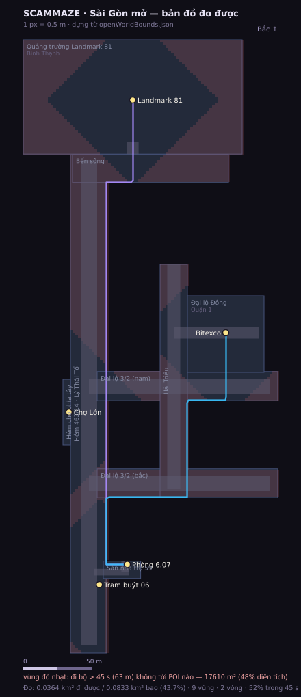

# Kiểm toán bản đồ mở Sài Gòn — 27/11/2026

> **Bản đồ thành phố 1:8 dùng trong game** (`cityGen.ts`) có bài kiểm toán riêng, độc lập với tài liệu
> này: xem [`CITY_MAP.md`](CITY_MAP.md) — 21 cổng đo trên lưới 0,5 m, ảnh `audit/city-plan.png`, và
> `node apps/game/scripts/city-audit.ts`.

Tài liệu này tồn tại vì một yêu cầu cụ thể: **bản đồ phải được nhìn tận mắt, đo, rồi mới được nói là
ổn** — "đẹp, thật, usable, không lỗi". Nó ghi lại cái đã nhìn thấy, số đo, và những lỗi đã sửa.

## 0. Nhìn bằng gì, khi không có trình duyệt

Sandbox này không có Chromium/Firefox/Playwright và không cài được (không có `apt` index, không tải
được CDN). Nên "nhìn" ở đây nghĩa là: **dựng lại bản đồ từ chính dữ liệu mà game dùng để chặn người
chơi, rồi render ra ảnh.** Không phải hình minh hoạ vẽ tay — mỗi ô 0,5 m trong ảnh là một ô
`isWithinOpenWorld(x, z) === true` thật.

```bash
node apps/game/scripts/audit-world.mjs      # đo + xuất SVG/PNG/JSON, exit 1 nếu có lỗi
npx vitest run src/features/testbus/openworld/world/openWorldBounds.test.ts   # 11 test khoá hình dạng
```

Đầu ra: `docs/product/audit/openworld-plan.png` (ảnh dưới), `openworld-plan.svg`, `openworld-metrics.json`.

**Giới hạn phải nói thẳng:** đây là *plan view* của vùng đi được. Nó bắt được lỗ hổng, vùng chết,
đường vẽ chồng lên chỗ không đi được, POI không tới được. Nó **không** nói được tường có đúng vật liệu
không, đèn có bị chớp không, collider của toà nhà có khít không. Phần 3D vẫn phải xem trên máy owner
(`/journey`, preview `https://5174-….e2b.app/journey`).

Một điều nữa phải nói rõ: `walkable` ở đây là **footprint của quận**, không phải sàn trống. Toà nhà
nằm trong footprint vẫn chặn người chơi bằng collider. Vì vậy 36.392 m² là **cận trên** của diện tích
đi được thật.

## 1. Ảnh — bản đồ đo được



Đọc ảnh:

- **Xám xanh** = footprint đi được, đúng toạ độ mét.
- **Đỏ nhạt** = chỗ đi bộ **hơn 45 giây** (63 m ở 1,4 m/s) mà không tới POI nào. Đây là "đi bộ không vì gì".
- **Xám đậm** = đường mà minimap vẽ (`saigonRoads.ts`), đè lên footprint để thấy chỗ nào đường vẽ
  nhưng không có đất dưới chân.
- **Chấm vàng** = POI; **tím/lam** = lộ trình đi bộ thật (BFS) từ phòng 6.07 tới Landmark 81 và Bitexco.

Nhìn ảnh là thấy ngay ba chuyện: bản đồ là **một cái lược** (một trục dọc 448 m, hai đường ngang dài
126 m, một vòng nhỏ ở Q1); **quảng trường Landmark 81 là một khoảng trống khổng lồ**; và **gần một nửa
diện tích bị tô đỏ**.

## 2. Số đo (lưới 0,5 m, tái lập được)

| Chỉ số | Giá trị | Ghi chú |
|---|---|---|
| Bao vùng chơi | x ∈ [−54, 132], z ∈ [−400, 48] → **186 × 448 m = 0,0833 km²** | |
| Đi được | **36.392 m² = 0,0364 km² (43,7 % bao)** | cận trên, chưa trừ toà nhà |
| Vùng rời rạc | **1** | không có đảo |
| Hình chữ nhật / cạnh / vòng | 9 / 10 / **2** | bản đồ gần như một đường thẳng |
| Chồng lấn giữa các vùng | 1.750 m² | chỗ nối, không tính trùng diện tích |
| POI | 5 (phòng, trạm buýt, Chợ Lớn, Bitexco, Landmark 81) | 137 POI/km², cách nhau TB 85 m |
| Đi bộ từ phòng 6.07 | buýt 36 m · Chợ Lớn 154 m · Bitexco 272 m · Landmark 374 m | 0,4 / 1,8 / 3,2 / 4,5 phút |
| Điểm xa nhất từ phòng | **498 m** | |
| Trong 45 s tới được POI | **52 % diện tích** (18.978 m²) | mục tiêu ≥ 80 % |
| Ngoài 45 s | **17.610 m² = 48 %** | chính là vùng đỏ trong ảnh |
| Khoảng cách tới POI gần nhất | trung vị **61,5 m**, xấu nhất **202 m** | |
| Đường minimap vẽ | 8 đoạn, **0 đoạn bị chặn** | sau khi sửa D1–D3 |

Diện tích từng vùng: `landmark-plaza` 13.376 m² (**36,8 % toàn bộ chỗ đi được**) · `ly-thai-to` 9.646 ·
`hai-trieu` 3.408 · `east-boulevard` 3.136 · `dai-lo-1` / `dai-lo-2` 2.798 mỗi bên · `riverside` 2.371 ·
`courtyard` 344 · `market-pocket` 264 m².

## 3. Lỗi tìm thấy

| ID | Mức | Bằng chứng | Trạng thái |
|---|---|---|---|
| **D1** | chặn chơi | Minimap vẽ Hải Triều tới z = −242, mặt đường và vỉa hè dừng ở −236 → **6 m tường vô hình** cuối phố | **đã sửa**: cắt đoạn vẽ về −236 |
| **D2** | sai sự thật | Đại lộ Lý Thái Tổ vẽ tới z = −365, nhưng nhựa đường dừng ở −312 → **53 m đường vẽ xuyên qua công viên cỏ** của Landmark 81 | **đã sửa**: dừng ở −312 |
| **D3** | sai sự thật | Một "đại lộ" 9,5 m ở z = −348 chạy **xuyên qua chân tháp Landmark 81** (sàn đá 64 × 62 m tại 26, −356) rồi 68 m trên cỏ | **đã sửa**: thay bằng lối vào thật 8,6 m ở x = 26, z −316,4 → −325 |
| **D4** | usability | Chợ Lớn — địa danh lớn nhất phía tây — chỉ có `market-pocket` **5,5 × 48 m**; POI cách mép 1,1 m. Người chơi **không thể bước vào chợ**, chỉ đi ngang một hành lang | chưa — cần dựng hình (V0.1) |
| **D5** | đẹp / usable | `landmark-plaza` 13.376 m² (**36,8 %** diện tích đi được) chỉ có **1** POI. Một phần ba bản đồ là sân trống | chưa — V0.2 |
| **D6** | nhịp chơi | **48 %** diện tích nằm ngoài 45 s tới POI; hai đại lộ 126 m **không có một điểm dừng nào**; trung vị 61,5 m | chưa — V0.3 |
| **D7** | tài liệu sai | Brief ghi "4 quận: Q10, Q5, Q1, Bình Thạnh"; dữ liệu thật **không có Q5** (có `Q10 → Q1`, `Q3 → Q1`) | chưa — sửa nhãn ở V0.3 |
| **D8** | đo lường | Footprint không chứa **khối đặc** (toà nhà), nên audit không trừ được vật cản; diện tích đi được thật thấp hơn 36.392 m² | chưa — V0.4 |

Cả ba lỗi D1–D3 đều cùng một nguyên nhân: **đường trên minimap được vẽ tay, không đọc từ hình học.**
Vì vậy danh sách đường đã được tách ra `apps/game/src/features/chapter1/hud/saigonRoads.ts` để audit
(`scripts/audit-world.mjs`) và test (`openWorldBounds.test.ts`) đọc **cùng một** danh sách, thay vì
tin vào mắt người vẽ.

## 4. Ngưỡng "đạt" — dùng để chấm, không để khoe

`audit-world.mjs` trả exit code 1 khi vi phạm. Các ngưỡng hiện có:

| Ngưỡng | Hiện tại | Đạt khi |
|---|---|---|
| Vùng rời rạc | 1 | = 1 |
| Đoạn đường vẽ chồng lên chỗ không đi được | 0 | = 0 |
| POI ngoài footprint / không tới được | 0 | = 0 |
| Diện tích đi được | 36.392 m² | 34.000–39.000 m² (lệch > 1 % phải audit lại + sửa doc) |
| Đi bộ tới POI trong 45 s | 52 % | **≥ 80 %** (thêm ở V0.5) |
| Khoảng cách tới POI gần nhất (trung vị) | 61,5 m | **≤ 40 m** |
| Một địa danh chiếm > 20 % diện tích đi được mà < 2 POI | vi phạm (D5) | không còn |

## 5. Việc tiếp theo, đúng thứ tự

1. **V0.1 — Chợ Lớn vào được** (D4): mở `market-pocket` thành sảnh chợ có lối đi giữa các sạp, footprint
   và hình học đi cùng một lần; POI nằm sâu ≥ 8 m trong chợ, không ở mép.
2. **V0.2 — Quảng trường Landmark 81** (D5): hoặc thu nhỏ còn ~6.000 m², hoặc thêm 3–4 neo (bến phà,
   quán cà phê ven sông, sân khấu, lối xuống hầm) để 13.376 m² có lý do tồn tại.
3. **V0.3 — Mặt tiền hai đại lộ** (D6, D7): mỗi 60 m có một cửa hàng/quán có tên; sửa nhãn quận cho
   khớp dữ liệu.
4. **V0.4 — Khối đặc trong dữ liệu** (D8): thêm `solids[]` (toà nhà, tường rào) vào `openWorldBounds.json`
   để audit trừ được diện tích chết.
5. **V0.5 — Audit lại**: chạy script, so ảnh mới với ảnh này, ghi số mới vào bảng trên. Không đạt ngưỡng
   §4 thì chưa gọi là xong.
