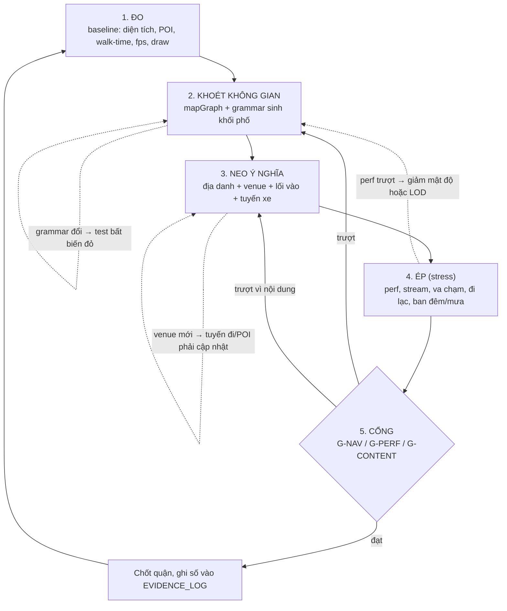

# Brief quy trình làm bản đồ (W2) — phi tuyến, đọc gì, làm bằng gì, nghiệm thu ra sao

> **Mục đích:** trước khi đụng vào hình học, nói rõ *cách tôi làm map*: nó không phải một đường
> thẳng "vẽ thêm đường → xong", mà là một vòng lặp có ràng buộc chéo. Tài liệu này là hợp đồng
> quy trình; kết quả từng bước ghi vào [EVIDENCE_LOG.md](./EVIDENCE_LOG.md).
>
> **Liên quan:** [BENCHMARK_GTA_STANDARD.md](./BENCHMARK_GTA_STANDARD.md) (chuẩn & điểm),
> [UPGRADE_PLAN_MUSIC_MAP_MISSIONS.md](./UPGRADE_PLAN_MUSIC_MAP_MISSIONS.md) (§5 — W2, task T20–T29),
> [MAP_AUDIT.md](./MAP_AUDIT.md) (bản đồ đã đo + ảnh + danh sách lỗi D1–D8).
> **Ngày:** 27/11/2026 · **Nhánh:** `arena/f56eaa67-scam-maze` · **Mốc code:** `86725f2`.

---

## 0. Một câu

**Map không phải "diện tích", mà là bốn thứ khoá vào nhau: chỗ để đi (diện tích) × chỗ để nhìn
(mật độ) × chỗ để chạy (hiệu năng) × chỗ để *xảy ra chuyện* (nội dung).** Đổi một cái là ba cái
kia lệch, nên quy trình bắt buộc phải phi tuyến.

---

## 1. Vì sao phi tuyến (và bằng chứng ngay trong code hiện tại)

### 1.1 Bốn ràng buộc chéo

```
        DIỆN TÍCH  ──────────►  thời gian đi lại, số quận, chi phí dựng
            ▲                                   │
            │                                   ▼
        MẬT ĐỘ  ◄────────────  số prop, NPC, xe, mặt tiền, ánh sáng
            │                                   │
            ▼                                   ▼
      HIỆU NĂNG  ◄───────────  draw call, RAM, thời gian stream
            │
            ▼
        NỘI DUNG  ──────────►  nhiệm vụ cần địa điểm; địa điểm cần lý do tồn tại
```

Không thể "làm xong hình học rồi mới tính hiệu năng", vì chính mật độ hình học quyết định hiệu
năng; cũng không thể "làm xong map rồi mới đặt nhiệm vụ", vì một địa điểm không có việc gì xảy ra
thì chỉ là phông nền — đúng lỗi hiện tại: **4 quận có tên nhưng gần như không có chỗ nào để *làm
việc***.

### 1.2 Ba bằng chứng lấy từ code đang chạy

| Chỗ trong code | Nó nói gì về quy trình |
|---|---|
| `saigonDistricts.ts:2406-2412` — `isWithinOpenWorld` gồm 6 dải chữ nhật, có comment *"Widen just the market block; leave the upstream neighbourhood boundaries elsewhere"* | Ranh giới đang được **vá tay từng lần thêm nội dung**. Đây chính là dấu hiệu "map lớn dần bằng bản vá", thứ W2 phải thay bằng hợp đồng hình học |
| `WorldStreamer.ts` — chunk có `nearDist`, `lodDist`, `hysteresis = 10`, `hydrate()` | Streaming **đã có** nhưng theo khoảng cách từng cụm, không theo ô bản đồ. Muốn rộng gấp 5,5 lần phải nâng thành "ô + hành lang ưu tiên" |
| `choLon.route.test.ts`, `longQ9.test.ts` | Đã có tiền lệ test **đường đi/điểm đỗ**, không chỉ test hình. Nghĩa là "map đúng" từ nay được đo bằng *đi được*, không bằng *trông giống* |

### 1.3 Hệ quả

Mỗi lần thêm một quận, tôi phải quay lại ba câu hỏi cũ: **đi bao lâu?**, **bao nhiêu draw call?**,
**có việc gì để làm ở đây?** — đó là lý do quy trình có vòng lặp, không có "bước 5: hoàn thành".

---

## 2. Vòng lặp thi công (5 bước, 3 cổng)



Ba vòng phản hồi thật (không phải hình vẽ cho đẹp):

1. **Perf → hình học:** nếu một ô 160 × 160 m vượt 250 draw call, tôi **không** hạ chất lượng toàn
   map; tôi giảm mật độ prop *của ô đó* và ghi lý do vào `DistrictSpec` (mỗi quận có `densityBudget`).
2. **Nội dung → tuyến:** nếu một nhiệm vụ lẻ cần "tiệm in" mà tiệm in nằm cách trạm buýt 900 m đi
   bộ, tôi **dời venue** hoặc **thêm điểm xe ôm**, chứ không bắt người chơi đi bộ 11 phút.
3. **Đi lạc → địa danh:** nếu người chơi không nhìn minimap vẫn không biết đang ở Q5 hay Q10, tôi
   thêm **dấu hiệu nhận dạng** (màu đèn, mùi chữ, độ ồn, kiến trúc), không thêm mũi tên HUD.

---

## 3. Tôi đọc gì — bên trong repo

Không đọc hết 13.000 dòng một lượt; đọc theo **câu hỏi**, mỗi file trả lời một câu.

| Nguồn trong repo | Câu hỏi nó trả lời | Dùng vào việc gì |
|---|---|---|
| `openworld/world/saigonDistricts.ts` (2.665 dòng) | Hình học hiện tại được dựng thế nào, ranh giới ở đâu | Baseline + mẫu chất lượng để grammar sinh ra không thua |
| `openworld/world/choLon.ts` (1.339) + `saigonRiverside.ts` | Một "địa danh" tốn bao nhiêu code, gồm những lớp gì | Ước lượng chi phí 7 địa danh mới |
| `openworld/world/WorldStreamer.ts` | Đang stream theo cụm hay theo ô; ngưỡng LOD, hysteresis | Thiết kế T23 (ô + hành lang ưu tiên) |
| `OpenWorldEngine.ts` (≈2.9k dòng) | Vòng update, va chạm, camera, prompt, snapshot | Biết chỗ nào được cắm thêm quận mà không phá frame |
| `openworld/simulation/*` (traffic, humanPresence, transit, longQ9) | Sinh hoạt đang có: xe, người, buýt, xe máy | Mật độ và lịch trình cho quận mới |
| `game/world/` (lifecycle, quality probe, stats) | Cổng chất lượng & đo fps đã có gì | Gắn ngân sách perf vào đúng chỗ |
| `features/chapter1/hud/SaigonMinimap.tsx` (315 dòng) | Bản đồ đang chiếu toạ độ thật → pixel thế nào | T26/T27: thêm quận, POI, blip |
| `game/narrative/chapter1/{mission01,mission01Offers,mission02}.ts` | Nhiệm vụ đang cần địa điểm nào, giờ nào | Chọn 7 quận theo *việc*, không theo bản đồ |
| `docs/gameplay/CHAPTER_01_LAST_SUBMISSION_JOURNEY.md` + `journey.ts` | Hành trình 72 giờ, mốc thời gian | Bảo đảm địa điểm mới khớp timeline |
| `vite.config.ts`, `docs/architecture/OVERVIEW.md` | Chạy/preview, route, kiến trúc tổng | Không phá route cũ khi nối map |
| `.kiro/specs/*` | Đặc tả cũ | Chỉ đọc để hiểu *ý định*, **không tin số liệu** (đã lệch code) |
| Test hiện có (`choLon.route`, `longQ9`, `mastsignal`, `furniture`) | Chuẩn "đúng" đang được kiểm bằng gì | Viết test mới cùng *giọng*, không phát minh style mới |

**Nguyên tắc đọc:** mỗi khẳng định trong tài liệu phải có một dòng code hoặc một phép đo đỡ lưng.
Tài liệu cũ (`PRODUCT_POSITIONING.md`, `OVERVIEW.md` phần Chapter 1) đã lệch — ví dụ OVERVIEW vẫn
mô tả chương "The Urgent Call" trong khi `activeScenario.ts` chạy `LAST_SUBMISSION`.

### 3.1 "Đọc bên trong và bên ngoài bản đồ"

- **Bên ngoài (street/exterior):** đọc *nhịp* — bề rộng mặt cắt đường, vỉa hè, mật độ mặt tiền, vị
  trí đèn, chỗ đỗ xe, luồng người. Nguồn: code hiện tại + tham chiếu Sài Gòn (§4).
- **Bên trong (interior/venue):** đọc *tỉ lệ và ánh sáng* — phòng trọ `roomv2` là chuẩn nội thất
  (1 đơn vị = 1 m, cửa 0,9 m, trần 3,0 m). Mọi nội thất mới **tái dùng tỉ lệ đó** và **phải nhìn ra
  một địa danh bên ngoài** (cửa sổ tiệm in nhìn thấy chợ), nếu không nội thất chỉ là hộp tối.

---

## 4. Tôi đọc gì — bên ngoài repo

### 4.1 Sài Gòn thật (để chọn tỉ lệ và cá tính quận)

| Quận | Diện tích thật | Mật độ dân số | Cá tính dùng trong game |
|---|---|---|---|
| Quận 10 | 5,72 km² | ~64.300 người/km² (dày nhất) | Hẻm nhỏ, nhà ống, chợ nhỏ, ồn — **nhà của Alex** |
| Quận 5 | 4,27 km² | ~41.000 | Chợ Lớn, người Hoa, đèn đỏ, chợ đêm — **tiệm in, mua bán** |
| Quận 1 | 7,72 km² | ~18.400 | Cao tầng, kính, ngân hàng, trường — **nộp bài, học bổng** |
| Quận 4 | 4,18 km² | ~48.700 | Bến tàu, chợ cá, sáng sớm — **cảnh nền, việc sáng** |
| Bình Thạnh | 20,76 km² | ~24.000 | Bến xe, ký túc xá, náo — **tìm nhà, xe ôm** |
| Quận 7 | 35,7 km² | ~9.100 | Đang xây, nhà mẫu, bụi — **"nhà giá rẻ"** |

Nguồn: bảng diện tích/dân số các quận TP.HCM ([ACC HCM](https://acchcm.vn/dien-tich-cac-quan-tphcm/),
[Batdongsan wiki](https://wiki.batdongsan.com.vn/wiki/ban-do-tp-hcm-808567)).

Ba điều rút ra, không phải để copy bản đồ:

1. **Mật độ mới là thứ tạo cảm giác "Sài Gòn".** Q10 dày gấp 7 lần Q7 trên cùng một km².
2. **0,35 km² là một "lát cắt" hợp lý:** bằng ~6% Q10 thật, đủ 7 quận *thu nhỏ* với mật độ cảm
   nhận gần thật, thay vì 9 km² rỗng.
3. **Ranh giới quận thật là sông/kênh/đại lộ**, nên trong game mỗi ranh giới phải có *vật thể*:
   kênh, cầu, đường lớn — không phải một đường kẻ vô hình.

### 4.2 Tỉ lệ đường phố (dùng làm tham số grammar)

| Thành phần | Khoảng thực tế | Ghi chú thiết kế |
|---|---|---|
| Nhà ống | mặt tiền 3,5–5 m, sâu 12–22 m, 2–4 tầng | Lô chuẩn trong grammar: 4 × 16 m |
| Hẻm | 3–6 m (hẻm chính 6 m, hẻm nhánh 3 m) | Phải đi lọt và nhìn thấy trời |
| Đường phố chính | 20–30 m mặt cắt | 2 làn + vỉa hè 2–3 m |
| Vỉa hè | 1,5–3 m | Tối thiểu 1,2 m để không kẹt |
| Khoảng cách "có thứ để nhìn" | 20–40 m | Mục tiêu: ≤ 45 s đi bộ giữa hai điểm tương tác |

(Đây là **khoảng thiết kế**, không phải số liệu khảo sát; nếu cần số chính xác sẽ đo từ bản đồ
đường phố mở và ghi nguồn.)

### 4.3 Bài học thiết kế từ GTA / Gangstar (không copy nội dung)

| Bài học | Áp vào SCAMMAZE |
|---|---|
| Quận có "nghề" riêng (khu tài chính, khu cảng, khu dân cư) | Mỗi quận có **một loại việc**: in ấn, cà phê, trọ, nộp bài, xe ôm |
| Địa danh làm mốc nhìn thấy từ xa (tháp, cầu, biển) | Bitexco, Landmark 81, chợ, cầu — đã có 2, thêm 3 |
| Đường vành đai + đường tắt | Vòng buýt 06 + hẻm tắt nối Q10–Q5 |
| "30 giây lại có chuyện" | POI/tương tác ≤ 45 s đi bộ; mỗi 120 m có biển hiệu/đèn/người |
| Ranh giới tự nhiên (sông, cao tốc) | Kênh, cầu, đại lộ — không tường vô hình |
| Bản đồ nhỏ mà dày (GTA IV) thắng bản đồ rộng mà rỗng | 0,35 km² nhưng **mỗi 100 m² đều có lý do** |

---

## 5. Phương pháp (6 kỹ thuật, theo thứ tự dùng)

### M1 — Đo trước khi vẽ (baseline, 1 phiên)

- Script đếm: diện tích bao, số quận, POI, địa danh, số dòng world, số GLB, draw call/fps ở 3 điểm.
- Kết quả hiện tại: **0,0364 km² đi được** trong bao 186 × 448 m (**0,0833 km²**), **4 quận có tên**
  (Q10, Q5, Q1, Bình Thạnh),
  6 landmark (`room/balcony/hem/bus/bitexco/landmark81`), ~13.300 dòng trong `openworld/world` (kể cả test), 41 GLB/73 MB.
- **Không có baseline thì mọi so sánh sau đó là cảm tính.**

### M2 — Hợp đồng không gian (`mapGraph`, T20)

- 1 đơn vị = 1 m; ô = 160 × 160 m; quận = tập ô; POI/venue có toạ độ + quận + loại.
- Graph có cạnh đi bộ/xe, trọng số = giây đi bộ thật; **mọi venue phải có ≥ 1 cạnh**.
- Test bất biến: liên thông, không ô chồng, toạ độ trong bao, không "đảo" không tới được.
- Đây là **nguồn sự thật duy nhất**; hình học chỉ là "render" của graph.

### M3 — Văn phạm khối phố (T21)

- `DistrictSpec` (dữ liệu) → `districtGrammar(seed)` → bundle (mesh, solid, POI, đèn, biển).
- Tất định: cùng seed → cùng hash geometry. Bất biến kiểm bằng test, không bằng mắt: nhà không đè
  đường, vỉa hè ≥ 1,2 m, lô không rỗng, mặt tiền luôn nhìn ra đường, tổng lô ≤ 85% ô.
- **60% sinh tự động, 40% đắp tay** (địa danh). Không đắp tay 0,35 km².

### M4 — Neo nội dung trước khi đắp chi tiết (T22, T24)

- Mỗi quận phải trả lời: *nhiệm vụ nào xảy ra ở đây? ai sống ở đây? người chơi đến đây vì gì?*
- Quy tắc: **≥ 1 venue cốt truyện + ≥ 2 venue nhiệm vụ lẻ** mỗi quận; nếu không đủ, quận đó bị cắt
  khỏi đợt này (thà 5 quận dày hơn 7 quận rỗng).
- Venue = cửa mở được → nội thất chạy bằng engine phòng (đã có `RoomOptions`/`RoomStoryPort`), preload standby.

### M5 — Streaming & ngân sách (T23, T28)

- Nâng `WorldStreamer` từ "cụm theo khoảng cách" thành **ô + hành lang ưu tiên**: ô đang đứng luôn
  nạp; ô phía trước theo hướng đi/lộ trình buýt được ưu tiên; ngân sách mỗi frame có hạn.
- Giữ `hysteresis` hiện có (10 m) để không nhấp nháy; đo hitch khi đi bộ và khi đi buýt.
- Ngân sách: 60 fps / 1% low ≥ 45; draw ≤ 900; RAM ≤ 700 MB; hitch ≤ 2 frame; vào chơi ≤ 15 s.

### M6 — Kiểm chứng trải nghiệm (T29)

Ba bài test tay, có biên bản + ảnh:

1. **Đi xuyên thành phố:** Q10 → Q5 → buýt → Q1, không nhìn bản đồ lần đầu; ghi số lần đi lạc.
2. **Nhận diện quận:** đứng ở 3 điểm bị bịt minimap, đoán quận; phải đúng ≥ 2/3.
3. **Mật độ:** 10 phút đi bộ, đếm số tương tác; mục tiêu ≥ 12.

---

## 6. Nghiệm thu — 4 tầng, không tầng nào thay được tầng nào

| Tầng | Kiểm gì | Công cụ | Ngưỡng đạt | Bằng chứng |
|---|---|---|---|---|
| **A. Bất biến dữ liệu** | Graph liên thông, không chồng lấn, grammar tất định, POI đúng quận | `mapGraph.test.ts`, `districtGrammar.test.ts` | 100% test xanh; cùng seed → cùng hash | log test |
| **B. Tích hợp & streaming** | Nạp/bỏ ô, không bỏ ô đang đứng, hitch, route buýt | `streaming.test.ts`, `transit.test.ts` | hitch ≤ 2 frame; không có ô "mồ côi" | log + video |
| **C. Hiệu năng** | fps, draw call, RAM, thời gian load ở 3 điểm | quality probe + `performance.now()` | 60/45 fps; ≤ 900 draw; ≤ 700 MB; ≤ 15 s | `EVIDENCE_LOG` |
| **D. Trải nghiệm & chuẩn** | Walkthrough, nhận diện quận, mật độ, điểm rubric | biên bản tay + `MAP_WALKTHROUGH.md` | đi bộ Q10→Q1 ≤ 12 phút; ≥ 12 tương tác/10 phút; D1 2→3, D2 3→4, D5 2→3 | ảnh + bảng điểm |

**Điều kiện dừng (quan trọng ngang điều kiện đạt):** dừng mở rộng khi (a) một quận mới làm D1 tăng
nhưng D11 giảm, (b) perf trượt quá 10% ngân sách, (c) phải thêm quá 2 "bản vá ranh giới" kiểu
`isWithinOpenWorld` để nối hình học. Gặp (c) là dấu hiệu phải sửa hợp đồng M2, không phải vá thêm.

**Revert:** một quận bị revert nếu sau 2 vòng stress vẫn không đạt A hoặc C; ghi lý do, giữ
`DistrictSpec` trong repo để lần sau làm lại.

---

## 7. Lịch thi công phi tuyến (3 vòng, không phải 3 giai đoạn sạch)

| Vòng | Làm gì | Có thể lặp lại vì | Xong khi |
|---|---|---|---|
| **V0 · Khảo sát** (1–2 phiên) | M1 baseline + M2 graph + chọn 7 quận theo nội dung + đo 1 ô mẫu | chọn quận đổi khi đọc lại nhiệm vụ | có bảng số baseline + graph test xanh |
| **V1 · Quận mẫu Q5** (2–3) | grammar + Chợ Lớn mở rộng + tiệm in (venue đầu tiên) + tuyến buýt | perf/nav buộc chỉnh grammar | Q5 chơi được: đi bộ, vào tiệm in, perf đạt |
| **V2 · Nhân bản 5 quận** (3–4) | chạy grammar cho Q10/Q3/Q1/BT/Q7 + 4 venue + POI/minimap | mỗi quận có thể trượt cổng | 0,35 km², 7 quận, 5 nội thất, walkthrough 12 phút |
| **V3 · Đánh bóng** (1–2) | lịch sinh hoạt theo giờ, ban đêm/mưa, biển hiệu, âm thanh vùng | nội dung W3 có thể đòi thêm chỗ | D1/D2/D5 đạt mục tiêu rubric |

V1 là **lát cắt dọc**: một quận đầy đủ còn hơn bảy quận dở. Nếu V1 không đạt, không được sang V2.

---

## 8. Rủi ro & câu hỏi cho owner

| Rủi ro | Chặn |
|---|---|
| Grammar sinh ra "nhà ống vô hồn" lặp mẫu | 7 bộ mặt tiền + biến thể màu/chiều cao; 40% đắp tay; test "không quá 3 lô giống nhau liền kề" |
| 0,35 km² vẫn loãng | cổng M4 (venue/quận) + M6 (mật độ) |
| Stream giật khi đi buýt | prefetch theo hành lang tuyến, ngân sách frame, đo hitch |
| Nội dung W3 cần địa điểm chưa có | thiết kế giấy W3 chạy song song; V2 giữ 1 ô "dự phòng" mỗi quận |
| Tên đường/quận thật gây hiểu lầm | dùng tên quận thật + tên đường **hư cấu** (trừ địa danh đã có: Bitexco, Landmark 81) |

**Cần owner chốt (mặc định tôi chọn):**

1. Tên đường: **hư cấu** (giữ tên quận thật) — tránh sai địa lý và tranh cãi. *(mặc định: hư cấu)*
2. Có giữ Bitexco/Landmark 81 không: **giữ** (đã có, là mốc nhìn thấy từ xa). *(mặc định: giữ)*
3. Ưu tiên mobile hay desktop: **desktop trước**, mobile chỉ cần không vỡ. *(mặc định: desktop)*

---

## 9. Phụ lục — con số baseline (đo 27/11/2026)

| Chỉ số | Giá trị | Nguồn |
|---|---|---|
| Bao vùng chơi | x ∈ [−54, 132], z ∈ [−400, 48] → 186 × 448 m = **0,0833 km²** | `node apps/game/scripts/audit-world.mjs` |
| Diện tích đi được | **36.392 m² = 0,0364 km²** (43,7 % bao), 1 vùng liên tục, 9 hình chữ nhật | `openWorldBounds.json` + audit (xem `MAP_AUDIT.md`) |
| Quận có tên | Q10, Q5, Q1, Bình Thạnh (+ "Q10 → Q1") | `grep district` trong `openworld/world` |
| Landmark | 6 (`room, balcony, hem, bus, bitexco, landmark81`) | `OpenWorldEngine.ts:81` |
| Dòng code world | `saigonDistricts` 2.665 + `choLon` 1.339 + riverside 284 + streamer 161 + PBR 531 | `wc -l` |
| Streaming | chunk theo khoảng cách, `hysteresis = 10 m`, có `hydrate()` | `WorldStreamer.ts` |
| Tài nguyên 3D | 41 GLB / 73 MB | `find` + `du` |
| Nhạc nền | 7 cue chờ file owner (đã có player + chọn cue) | `musicManifest.json` |
